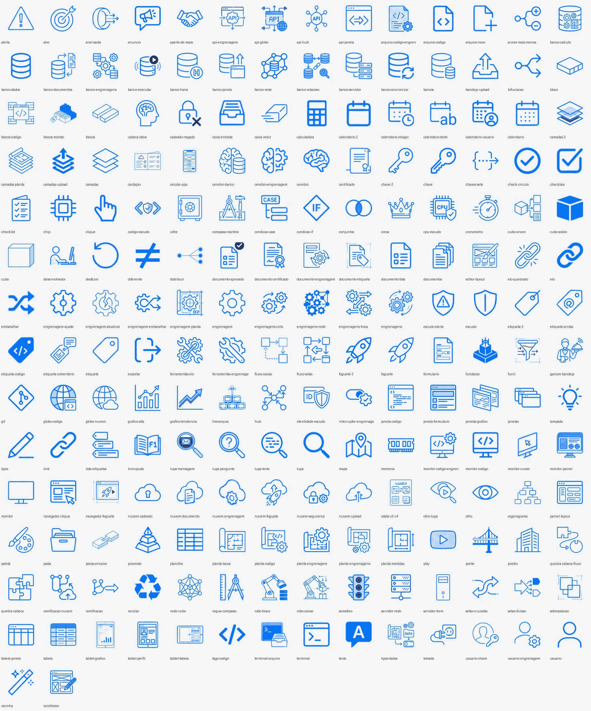

# Biblioteca de ícones

Ícones extraídos das apresentações de referência geradas com o NotebookLM (as versões em PDF de cada aula, convertidas para PPTX) e recoloridos com a paleta **SAP Horizon** usada nos slides deste repositório.

## Variantes

| Pasta | Traço principal | Acento | Uso |
| :--- | :--- | :--- | :--- |
| [`horizon-claro/`](./horizon-claro) | `#0070F2` (Brand) | `#00144A` (Navy) | Slides e páginas com fundo claro |
| [`horizon-escuro/`](./horizon-escuro) | `#89D1FF` (Sky) | `#FFFFFF` | Capas e divisórias com fundo escuro |

São 198 ícones em PNG com fundo transparente, 160 a 256 px, nomeados em português pelo significado (`banco-dados.png`, `quebra-cabeca.png`, `nuvem-cadeado.png`…). O catálogo do fundo escuro está em [`catalogo-escuro.png`](./catalogo-escuro.png).

## Como foram adaptados

1. Todas as imagens das 34 apresentações de referência foram extraídas, e as duplicadas descartadas (2.759 imagens únicas).
2. Um filtro automático separou os candidatos a ícone (proporção, tamanho e quantidade de traço); a seleção final foi feita à mão, sem recortes de texto, molduras, fundos, logotipos de produtos nem ilustrações com o cenário de viagens.
3. Cada ícone virou uma máscara: o traço vira transparência e as cores originais (azul, vermelho, dourado, verde) são classificadas em **traço principal** ou **acento**.
4. A máscara foi pintada com as cores da paleta e otimizada.

[`origem.json`](./origem.json) indica, para cada ícone, a apresentação de referência e a imagem de onde ele saiu. O número da apresentação segue a numeração antiga dos módulos, anterior à reorganização na ordem de estudo.

## Uso nos slides

Os decks das aulas usam estes ícones nas capas, na jornada do módulo, nas divisórias de seção e nos cartões. O gerador pinta cada máscara na cor do contexto (azul nos cartões claros, azul-céu nas divisórias escuras, branco na capa), então o mesmo ícone serve para qualquer fundo.
