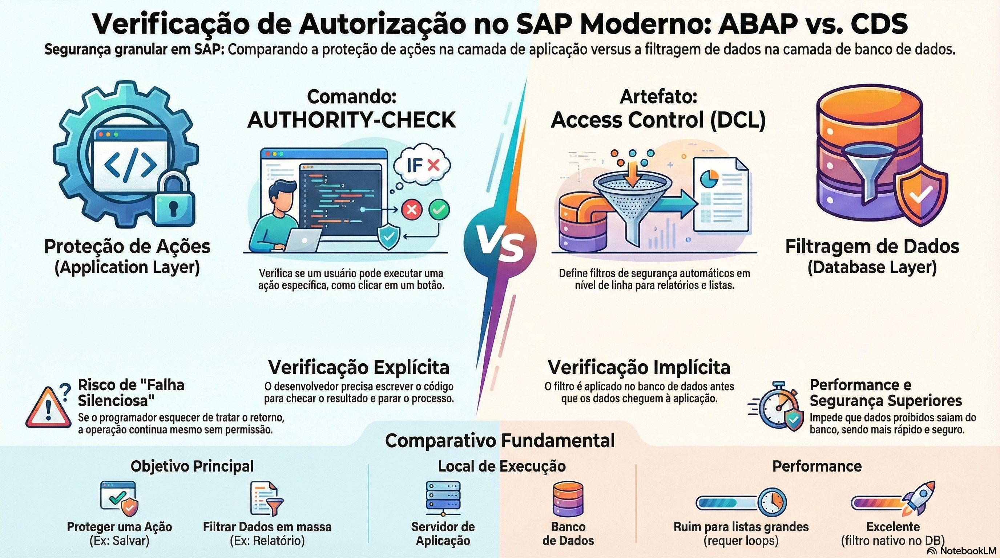

# Implementando Verificações de Autorização



> **Comece pelos slides: [Implementando verificações de autorização](./02.06_Implementando_verificações_de_autorização.pptx)**
>
> Material complementar em PDF: [Segurança e Autorização no ABAP](./02.06_Seguranca_e_Autorizacao_no_ABAP.pdf)
>
> **Referência oficial (ABAP Keyword Documentation):** [ABAP CDS - Access Control](https://help.sap.com/docs/abap-cloud/abap-keywords/abap-cds-access-control)

## Objetivos de Aprendizagem

- Compreender profundamente a arquitetura de segurança do SAP baseada em **RBAC (Role-Based Access Control)**, identificando a hierarquia entre Usuários, Papéis (Roles), Perfis e Objetos de Autorização.  

- Implementar verificações de segurança explícitas no código ABAP utilizando o comando **AUTHORITY-CHECK**, interpretando corretamente os códigos de retorno (sy-subrc) para garantir a robustez da aplicação.  

- Criar e manter controles de acesso automáticos ("Row-Level Security") em CDS Views utilizando **DCL (Data Control Language)** e a função de aspecto pfcg_auth.  

- Diferenciar estrategicamente a segurança aplicada na **Aplicação** (proteção de ações/botões) da segurança aplicada nos **Dados** (filtragem de leitura), sabendo quando aplicar cada paradigma no modelo RAP.

## 1. O Modelo de Segurança SAP: Uma Visão Arquitetural

A segurança no SAP não é binária (acesso/sem acesso); é granular e baseada em contexto. O modelo segue o padrão da indústria **RBAC (Role-Based Access Control)**, onde as permissões são agrupadas em funções de negócio, não atribuídas diretamente aos usuários.

### A Hierarquia de Autorização

1. **User Master Record (Usuário):** A identidade de login (ex: JOAO_SILVA).  

2. **Role (Papel - Transação PFCG):** Um conjunto de tarefas que uma pessoa realiza (ex: "Comprador Sênior", "Auditor Fiscal"). Um usuário pode ter vários papéis.  

3. **Profile (Perfil):** O objeto técnico gerado pela Role que contém as autorizações compiladas. O Kernel do ABAP verifica o perfil, não a Role.  

4. **Authorization Object (Objeto de Autorização):** A menor unidade de verificação. É a "fechadura". Ele define *o que* está sendo protegido (ex: "Documento de Vendas") e *quais atributos* são relevantes (ex: "Empresa", "Canal de Distribuição", "Atividade").  
   * **Campos:** Cada objeto tem até 10 campos.  
   * **ACTVT (Activity):** Um campo especial presente na maioria dos objetos que define a ação (01=Criar, 02=Alterar, 03=Exibir, 06=Excluir).

## 2. Verificação Explícita: AUTHORITY-CHECK (ABAP)

Quando estamos escrevendo lógica de negócio processual (ex: dentro de um método de uma classe, uma BAdI ou uma Ação de um Business Object RAP), precisamos verificar se o usuário tem permissão para *executar* aquela operação específica.

O comando **AUTHORITY-CHECK** é a instrução ABAP que consulta o buffer de autorizações do usuário na memória.

### Sintaxe e Comportamento

O comando verifica se o usuário possui *alguma* autorização em seu perfil que corresponda a *todos* os valores especificados.

``` ABAP
" Cenário: Verificar se o usuário pode ALTERAR (02) dados da Agência 000001  
AUTHORITY-CHECK OBJECT 'S_AGENCY'    " Nome do Objeto de Autorização (SU21)  
  ID 'AGENCYNUM' FIELD '000001'      " Valor específico que queremos checar  
  ID 'ACTVT'     FIELD '02'.         " 02 = Alterar

" Análise do Retorno (sy-subrc)  
CASE sy-subrc.  
  WHEN 0.  
    " Sucesso: O usuário tem permissão. Prosseguir.  
  WHEN 4.  
    " Falha: O usuário não tem autorização para os valores especificados.  
    " Ação: Bloquear o processo e lançar erro.  
    RAISE EXCEPTION TYPE cx_demo_auth_failure.  
  WHEN 12.  
    " Falha: Nenhuma autorização foi encontrada para o objeto 'S_AGENCY'  
    " (o usuário não tem nenhuma autorização para ele — ou o objeto nem existe).  
    " Ação: Tratar também como falta de autorização (e verificar o nome do objeto).  
    RAISE EXCEPTION TYPE cx_demo_auth_failure.  
  WHEN OTHERS.  
    " Outros erros (ex: 24 = campos incorretos, 40 = usuário inválido).  
ENDCASE.
```

* **Pontos Críticos:**
  * **Falha Silenciosa:** O AUTHORITY-CHECK por si só **não para** o programa. Se você esquecer de checar o sy-subrc, o código continuará executando mesmo se o usuário não tiver permissão.  
  * **Dummy Checks:** Se você omitir um campo do objeto (ex: não checar ACTVT), ele simplesmente não é verificado — o mesmo efeito de especificar `ID 'ACTVT' DUMMY`. Prefira listar todos os campos explicitamente, usando `DUMMY` apenas quando a omissão for intencional.

## 3. Verificação Implícita: CDS Access Control (DCL)

Imagine um cenário onde você precisa exibir um relatório de Viagens. A tabela tem 10 milhões de registros. O usuário João só pode ver viagens da Agência "Rio de Janeiro".

* **Abordagem Antiga (Ineficiente):**  
  1. SELECT * FROM viagens (Traz 10 milhões de linhas para o ABAP).  
  2. LOOP.  
  3. AUTHORITY-CHECK.  
  4. Se falhar, DELETE a linha.  
  5. ENDLOOP.  
     Resultado: Estouro de memória e lentidão extrema.  

* **Abordagem Moderna (DCL - Data Control Language):** 
  No modelo RAP e S/4HANA, aplicamos a segurança diretamente na consulta ao banco de dados. O DCL funciona como um filtro WHERE dinâmico e invisível que o runtime ABAP injeta automaticamente na consulta antes de enviá-la ao banco de dados (HANA).

### Anatomia de um Arquivo DCL

O DCL é um artefato separado (extensão `.dcls`) que protege uma CDS View específica.

``` CDS
@EndUserText.label: 'Controle de Acesso para Viagens'  
@MappingRole: true  
define role Z_I_TRAVEL_DCL {  
    
  // Define que estamos protegendo a view Z_I_TRAVEL  
  grant select on Z_I_TRAVEL  
    
  // A cláusula WHERE define a regra.  
  // aspect pfcg_auth é a função mágica que conecta com os perfis do usuário (PFCG)  
  where ( AgencyID ) = aspect pfcg_auth( S_AGENCY,      // Objeto de Autorização  
                                         AGENCYNUM,     // Campo do Objeto  
                                         ACTVT = '03'   // Filtro Fixo: Apenas Leitura  
                                       );  

}
```

**Como funciona em tempo de execução?** Quando qualquer programa (Fiori, GUI, API) executa `SELECT * FROM Z_I_TRAVEL`, o runtime ABAP lê as autorizações do usuário atual. Se o usuário tiver acesso apenas à agência '001', a query enviada ao banco é reescrita internamente para:  
``` ABAP
SELECT * FROM Z_I_TRAVEL WHERE AgencyID = '001'.  
```

**Vantagens:**
  1. **Performance:** O dado proibido nunca sai do banco de dados.  
  
  2. **Segurança Universal:** Não importa quem chama a view, a regra é aplicada. É impossível um desenvolvedor esquecer de fazer o check.

## 4. Exemplo Prático: Protegendo uma Ação de Negócio

No exemplo abaixo (trecho simplificado: supõe que `is_travel` e `out` estejam disponíveis no método), combinamos a segurança de dados (DCL na View, não mostrado aqui) com a segurança de aplicação (`AUTHORITY-CHECK` no método). O usuário pode ver a viagem (graças ao DCL), mas vamos verificar se ele tem poder de "Aprovação".

``` ABAP
CLASS zcl_auth_demo IMPLEMENTATION.

  METHOD accept_travel.  
    " Entrada: Estrutura da viagem contendo o ID da agência  
      
    " 1. Preparação dos dados  
    DATA(lv_agency_id) = is_travel-agency_id.  
      
    " Definimos que a atividade '02' (Modificar) ou uma customizada '70' (Admin)  
    " é necessária para aprovar. Vamos usar '02' neste exemplo.  
    CONSTANTS: lc_actvt_approve TYPE activ_auth VALUE '02'.

    " 2. Execução da Verificação  
    AUTHORITY-CHECK OBJECT 'Z_O_TRAVEL'      " Objeto Customizado Z  
      ID 'AGENCY_ID' FIELD lv_agency_id      " Verifica a jurisdição (Agência)  
      ID 'ACTVT'     FIELD lc_actvt_approve. " Verifica a ação

    " 3. Tomada de Decisão  
    IF sy-subrc = 0.  
      " Sucesso: Loga auditoria e prossegue  
      out->write( |Usuário { sy-uname } autorizado a aprovar viagem da agência { lv_agency_id }.| ).  
      " ... lógica de aprovação ...  
        
    ELSE.  
      " Falha: qualquer valor diferente de 0 significa "não autorizado"  
      " (4 = sem autorização para os valores; 12 = nenhuma autorização para o objeto)  
      out->write( |Erro: Usuário { sy-uname } sem permissão de aprovação para agência { lv_agency_id }.| ).  
        
      " Em RAP, adicionaríamos uma mensagem ao container REPORTED  
      " APPEND VALUE #( ... ) TO reported-travel.  
    ENDIF.

  ENDMETHOD.

ENDCLASS.
```

## 5. Tratando Erros de Autorização (SU53 e Trace)

No desenvolvimento e suporte, é comum o usuário relatar: "Não vejo o botão" ou "A lista está vazia".

* **Transação SU53:** Ferramenta padrão. O usuário deve executá-la imediatamente após o erro. Ela mostra a *última* verificação de autorização falha. Mostra o objeto, os campos esperados e o que o usuário realmente tinha.  

* **Trace de Autorizações (ST01 / STAUTHTRACE):** Para análises mais complexas (ex: múltiplas verificações em cadeia), esses traces registram todas as checagens de autorização executadas durante um período.  

* **SACF (Switchable Authorization Check Framework):** Permite ativar, desativar ou colocar em modo de log as verificações de autorização "comutáveis" entregues pela SAP, sem alterar o código.

## Comparativo: ABAP Check vs CDS DCL

| Característica | AUTHORITY-CHECK (ABAP) | Access Control (DCL / CDS) |
| :---- | :---- | :---- |
| **Local de Execução** | Servidor de Aplicação (Código ABAP). | Banco de Dados (HANA / SQL). |
| **Objetivo Principal** | Proteger uma **Ação** ou Transação (Botão, Método). | Filtrar **Dados** em massa (Lista, Relatório). |
| **Performance** | Ruim para filtros de lista (exige loops). | Excelente (filtro nativo no DB). |
| **Comportamento** | Explícito (Dev deve escrever o IF). | Implícito (Automático no SELECT). |
| **Retorno** | Código de erro (sy-subrc). | Conjunto de dados reduzido (menos linhas). |

## Glossário Técnico

* **Authorization Object (Objeto de Autorização):** Estrutura lógica definida na transação SU21 que agrupa até 10 campos de autorização. É a base da verificação de segurança no código ABAP.  

* **ACTVT (Activity):** Campo padrão (valores válidos na tabela TACT) presente na maioria dos objetos de autorização. Define a operação permitida (ex: 01=Criar, 02=Alterar, 03=Exibir, 16=Executar).  

* **DCL (Data Control Language):** Linguagem declarativa usada para definir objetos de controle de acesso (Access Control) para CDS Views. Permite a implementação de "Row-Level Security" (Segurança em Nível de Linha) automática.  

* **PFCG_AUTH:** Função de aspecto (aspect) usada exclusivamente dentro de arquivos DCL para mapear campos da CDS View contra os valores de autorização presentes no perfil do usuário atual.  

* **SU53:** Transação de diagnóstico que exibe os dados da última verificação de autorização que falhou para o usuário logado. Essencial para depuração de problemas de acesso.

## Quiz de Fixação

1. O que acontece se eu criar uma CDS View com a anotação @AccessControl.authorizationCheck: #CHECK, mas não criar um arquivo DCL correspondente?  
  R: O sistema emitirá um aviso (warning) durante a ativação, indicando que o controle de acesso não foi encontrado. Em tempo de execução, a view se comportará como se tivesse acesso total ("Full Access"), retornando todos os dados sem filtro de segurança. Se a anotação fosse #MANDATORY, o comportamento poderia ser restritivo ou gerar erro dependendo da versão do sistema.  

2. Qual é o valor padrão do campo ACTVT (Atividade) utilizado universalmente no ecossistema SAP para verificar permissão apenas de leitura/visualização?  
  R: O valor '03' (Display).  

3. Por que o uso de DCL (Data Control Language) é considerado uma "Best Practice" para relatórios Fiori em comparação ao uso de AUTHORITY-CHECK dentro de loops?  
  R: Porque o DCL implementa o conceito de "Code Pushdown", aplicando as restrições de segurança diretamente na camada de banco de dados. Isso evita a transferência desnecessária de dados sensíveis ou irrelevantes para o servidor de aplicação e elimina a necessidade de loops custosos em ABAP para filtrar registros linha a linha, resultando em performance superior e código mais limpo.
