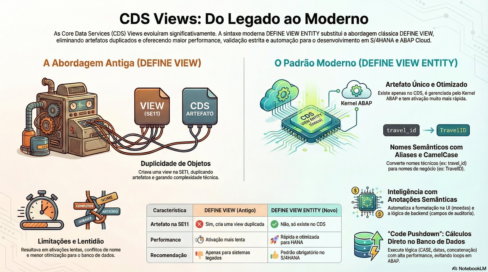

# Definindo CDS Views Básicas (Interface Views)



> **Comece pelos slides: [Definindo CDS views básicas](./03.04_Definindo_CDS_views_básicas.pptx)**
>
> Material complementar em PDF: [A Base de Aplicações Modernas: Dominando as CDS Views Essenciais](./03.04_CDS_Views_Essenciais_Uma_Nova_Arquitetura.pdf)
>
> **Referência oficial (ABAP Keyword Documentation):** [ABAP CDS - View Entities](https://help.sap.com/docs/abap-cloud/abap-keywords/abap-cds-view-entities)

## Objetivos de Aprendizagem

- Escrever uma **CDS View Entity** utilizando a sintaxe moderna e estrita, compreendendo as melhorias de performance e arquitetura em relação às views clássicas.  

- Aplicar rigorosamente as convenções de nomenclatura do **Virtual Data Model (VDM)**, diferenciando **Interface Views (`I_`)** de **Consumption Views (`C_`)** e entendendo o propósito de reutilização de cada uma.  

- Utilizar **Aliases** estrategicamente para converter nomes técnicos legados (ex: `MATNR`) para nomes semânticos em **CamelCase** (ex: MaterialID), facilitando o consumo por interfaces web (_UI5/Fiori_).  

- Entender a diferença técnica crítica entre `DEFINE VIEW` (Obsoleto, gera artefatos `SE11`) e `DEFINE VIEW ENTITY` (Novo Padrão, gerenciado pelo Kernel ABAP).

## 1. A Nova Sintaxe: View Entity vs. CDS View Clássica

Nos primeiros anos da tecnologia CDS (_Core Data Services_), utilizávamos o comando `DEFINE VIEW`. Embora revolucionário, ele carregava um débito técnico: a duplicidade de artefatos.

### O Problema da Abordagem Antiga (`DEFINE VIEW`)

Ao ativar uma CDS View clássica, o sistema criava dois objetos:

1. **Entidade CDS:** O objeto rico em semântica, visível no Eclipse.  
2. View de Banco de Dados (DDIC View): Uma view clássica na transação `SE11` (com limite de 16 caracteres no nome).  
   Consequência: Isso gerava problemas de namespace, ativações lentas e limitações técnicas, pois a view precisava ser compatível com as regras antigas do Dicionário ABAP.

### A Solução Moderna (`DEFINE VIEW ENTITY`)

Desde o ABAP 7.55 (e padrão obrigatório no ABAP Cloud), usamos **`DEFINE VIEW ENTITY`**.

* **Sem Artefato `SE11`:** Não cria nenhuma view na `SE11`. A entidade existe apenas no nível do CDS e é gerenciada diretamente pelo Kernel ABAP e pelo banco de dados HANA.  
* **Verificação Estrita:** O compilador é mais rigoroso. Tipos de dados devem coincidir perfeitamente, e certas ambiguidades do SQL antigo não são toleradas, resultando em código mais limpo e seguro.  
* **Performance:** A ativação é muito mais rápida, e o plano de execução no banco de dados pode ser otimizado de forma mais eficiente pelo otimizador do HANA.

## 2. Estrutura de uma CDS View

Uma View CDS é um artefato de código fonte (_DDL - Data Definition Language_) composto por três partes principais:

### A. Anotações (Header Annotations)

Configurações técnicas que precedem a definição. Começam com `@`.

* **`@AccessControl.authorizationCheck`:** Define se a view terá controle de acesso automático (DCL). Para Interface Views básicas, muitas vezes usamos `#NOT_REQUIRED` ou `#CHECK`.  
* **`@EndUserText.label`:** A descrição da view. Não é obrigatória, mas é fortemente recomendada (o template do ADT já a inclui).

### B. Definição e Fonte de Dados

Onde declaramos o nome da entidade e de onde ela busca dados. Veja o exemplo abaixo:  
``` CDS
define view entity NomeDaView as select from FonteDeDados as Alias
```

### C. Lista de Seleção (Projection List)

O "miolo" da view, dentro das chaves `{ }`. Aqui selecionamos campos, criamos cálculos, expomos associações e aplicamos anotações de campo.

### Convenção de Nomes e VDM (Virtual Data Model)

O VDM organiza as milhares de views do S/4HANA.

* **Interface Views (`I_`):** A base da pirâmide. Devem ser agnósticas de UI, reutilizáveis e estáveis. Espelham os dados do negócio. Ex: `I_SalesOrder`; no RAP, as views `R_` do business object, como `ZR_PC_PEDIDO`.  
* **Consumption Views (`C_`):** O topo da pirâmide. Específicas para um aplicativo ou relatório. Consomem as Interface Views. Ex: `ZC_PC_PEDIDO_APP` (app de pedidos) e `ZC_PC_PEDIDO_ANALISE` (análise).

## 3. Exemplo Prático: A View Base dos Pedidos

A view `ZR_PC_PEDIDO` do projeto [Pedidos de Compras](https://github.com/AdrianoBispo/sap-abap-rap-pedidos-de-compras-app) lê a tabela física `ZTA_PC_PEDIDO` e transforma seus campos técnicos em uma interface de negócio limpa. No RAP ela é a view `R_` (root) do business object, mas cumpre o papel de interface view descrito acima.

**Atenção ao CamelCase:** Note como usamos `PedidoUUID` em vez de deixar `pedido_uuid`. Interfaces modernas (_Fiori_, _React_, _APIs REST_) padronizam o uso de CamelCase. Se mandarmos `PEDIDO_UUID`, o frontend _JavaScript_ terá que lidar com nomes fora do padrão. O CDS resolve isso na fonte.

``` CDS
@AccessControl.authorizationCheck: #NOT_REQUIRED  
@EndUserText.label: 'Pedido de compra - BO root'  
@Metadata.ignorePropagatedAnnotations: true 

define root view entity ZR_PC_PEDIDO  
  as select from zta_pc_pedido
{  
  /* Chaves: Essenciais para o funcionamento do OData e navegação */  
  key pedido_uuid           as PedidoUUID,

  /* Campos de Identificação de Negócio */  
  numero_pedido         as NumeroPedido,  
  cliente_uuid          as ClienteUUID,  
    
  /* Status do Processo */  
  status_pedido         as StatusPedido,  
  status_pagamento      as StatusPagamento,  
    
  /* Valores Monetários: A ligação Semântica é feita aqui ou na tabela */  
  currency              as Currency,  
  @Semantics.amount.currencyCode: 'Currency'  
  valor_total           as ValorTotal,  
    
  /* Descrições e Datas */  
  observacao            as Observacao,  
  data_finalizacao      as DataFinalizacao,

  /* --- Campos de Auditoria (Admin Data) --- */  
  /* Estas anotações permitem que o RAP preencha os dados automaticamente */  
  @Semantics.user.createdBy: true  
  created_by            as CreatedBy,  
    
  @Semantics.systemDateTime.createdAt: true  
  created_at            as CreatedAt,  
    
  @Semantics.user.lastChangedBy: true  
  last_changed_by       as LastChangedBy,  
    
  @Semantics.systemDateTime.lastChangedAt: true  
  last_changed_at       as LastChangedAt,

  @Semantics.systemDateTime.localInstanceLastChangedAt: true  
  local_last_changed_at as LocalLastChangedAt
}
```

## 4. Anotações Semânticas: O Segredo da Automação

No código acima, as anotações @Semantics não são decorativas; elas alteram o comportamento do sistema.

### Semântica de Moeda e Quantidade

* `@Semantics.amount.currencyCode: 'Currency'` 
  * **O que faz:** Vincula o campo de valor (ValorTotal) ao campo de moeda (Currency).  
  * **Impacto na UI:** O Fiori Elements sabe que não deve apenas mostrar "100", mas sim "100,00 BRL" ou "100 JPY" (sem decimais), aplicando a formatação correta baseada na moeda.

### Semântica de Auditoria (RAP Managed)

* `@Semantics.user.createdBy: true`  
  * **O que faz:** Marca o campo como "Usuário de Criação".  
  * **Impacto no Backend:** Em um cenário RAP Managed (que veremos adiante), o framework identifica essa anotação e preenche automaticamente o campo com o usuário logado (sy-uname) no momento do INSERT. O desenvolvedor não precisa escrever uma linha de código para isso.

## 5. Code Pushdown: Cálculos na View

Uma das maiores vantagens do CDS é realizar cálculos linha a linha diretamente no banco de dados, evitando loops no ABAP.

### Lógica Condicional (CASE)

Categorizar dados na fonte é muito mais eficiente.

``` CDS
case   
  when total_price > 1000 then 'High Value'   
  when total_price > 500  then 'Medium Value'  
  else 'Low Value'   
end as PriceCategory
```

### Operações de String e Data

Funções embutidas permitem tratar dados brutos. Veja o exemplo abaixo:
``` CDS
/* Concatenação */  
concat_with_space(first_name, last_name, 1) as FullName

/* Cálculo de Dias */  
dats_days_between(begin_date, end_date) as DurationDays

/* Conversão de Tipo (Casting) */  
cast(total_price as abap.dec(17,2)) as PriceDecimal
```

## Comparativo: DDIC View vs CDS View Entity

| Característica | ``DEFINE VIEW`` (Antigo) | ``DEFINE VIEW ENTITY`` (Novo) |
| ----- | ----- | ----- |
| **Artefato `SE11`** | Cria uma View de Banco de Dados | Nenhum (Só existe no CDS) |
| **Performance** | Mais lenta na ativação | Mais rápida e otimizada |
| **Cálculos** | Limitados em alguns cenários | Suporte total a expressões SQL |
| **Recomendação** | Apenas para legado (7.40) | Sempre usar no S/4HANA |

## Glossário Técnico

* **CDS View Entity:** A evolução da CDS View. Uma entidade de projeção SQL gerenciada inteiramente pelo kernel ABAP, que não gera artefatos correspondentes no Dicionário ABAP clássico (`SE11`). Oferece melhor performance e validação de sintaxe.  

* **Alias (Apelido):** Nome alternativo dado a um campo na lista de seleção (usando as NovoNome). No VDM, usamos Aliases para converter nomes técnicos do banco (MATNR) para nomes legíveis e padronizados (MaterialID).  

* **CamelCase:** Estilo de escrita onde as palavras são unidas sem espaços e cada palavra subsequente começa com maiúscula (ex: DataFinalizacao). É o padrão para nomes de campos em CDS Views modernas para facilitar o consumo por JavaScript/UI5.  

* **Key (Chave):** Palavra-chave obrigatória em CDS Views. Define quais campos identificam unicamente um registro. Sem chaves definidas corretamente, o framework OData não consegue realizar operações de leitura (Read) ou navegação em registros individuais.  

* **`@Semantics`:** Família de anotações que descrevem o significado do dado (ex: isto é um e-mail, isto é uma moeda, isto é um usuário de criação). Essencial para automações do framework RAP e renderização correta no Fiori.

## Quiz de Fixação

1. Qual é a principal diferença técnica entre usar `DEFINE VIEW` e `DEFINE VIEW ENTITY`?  
  R: `DEFINE VIEW` cria uma View CDS e uma View de Banco de Dados clássica (`SE11`) duplicada, o que pode causar conflitos de nome e overhead. `DEFINE VIEW ENTITY` cria apenas a entidade CDS, sendo processada inteiramente pelo runtime do CDS e otimizada para o HANA, sem gerar artefatos desnecessários no dicionário.

2. Por que renomeamos os campos usando Aliases (ex: `numero_pedido` as `NumeroPedido`) nas Interface Views?  
  R: Para padronizar os nomes seguindo a convenção CamelCase. Isso torna o modelo de dados semanticamente mais rico e amigável para o desenvolvimento de interfaces web (UI5/Fiori) e APIs OData, que naturalmente utilizam esse padrão de nomenclatura.

3. O que acontece se eu esquecer de marcar um campo com a palavra-chave key na CDS View?  
  R: A view funcionará sintaticamente para seleções em massa, mas poderá causar erros graves ao ser consumida por frameworks OData ou Fiori Elements. Esses frameworks precisam saber qual é o identificador único da linha para realizar operações de leitura de detalhe, edição ou navegação.

4. Para que serve a anotação `@Semantics.user.createdBy: true` em um cenário _RAP Managed_?  
  R: Ela instrui o framework RAP a preencher automaticamente esse campo com o ID do usuário logado durante a operação de criação (CREATE) do registro, eliminando a necessidade de implementação manual dessa lógica.
