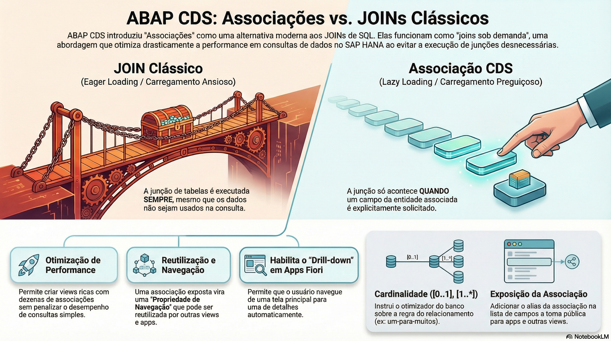

# Definindo Relacionamentos e Associações



> **Comece pelos slides: [Relacionamentos e associações](./03.05_Relacionamentos_e_associações.pptx)**
>
> Material complementar em PDF: [A Revolução Silenciosa: De Joins a Associações em ABAP CDS](./03.05_JOINs_para_Associações_ABAP_CDS.pdf)
>
> **Referência oficial (ABAP Keyword Documentation):** [CDS DDL - CDS View Entity, SELECT, Associations](https://help.sap.com/docs/abap-cloud/abap-keywords/cds-ddl-cds-view-entity-select-associations)

## Objetivos de Aprendizagem

- Compreender profundamente a diferença arquitetural e de performance entre **JOINs** (SQL Clássico / Eager Loading) e **Associações** (CDS / Lazy Loading).
 
- Definir associações complexas utilizando a sintaxe association to ..., incluindo o uso de condições ON e parâmetros.
  
- Interpretar e configurar a **Cardinalidade** (`[0..1]`, `[1..*]`, `[1..1]`), entendendo como ela influencia o otimizador do banco de dados e a geração de JOINS físicos.
  
- Expor associações na lista de projeção para habilitar **Propriedades de Navegação** em serviços OData, permitindo que aplicações Fiori naveguem entre entidades (Drill-down).

- Diferenciar **chaves estrangeiras** do Dicionário (relação entre tabelas) de **associações** CDS (relação entre views).

## 1. O Conceito de Associação ("Join on Demand")

A introdução das **Associações** no ABAP CDS representa uma mudança de paradigma na forma como pensamos sobre relacionamentos de dados.

* **A Abordagem Clássica (JOIN):** Em views SQL tradicionais (ou num `JOIN` escrito diretamente na view), quando definimos um `LEFT OUTER JOIN` entre "Pedido" e "Cliente", o banco de dados executa essa junção fisicamente **toda vez** que a view é lida. Se o seu relatório precisa apenas do ID do Pedido e do Valor Total, o banco desperdiça recursos buscando o Endereço do Cliente, mesmo que essa informação nunca seja exibida. Isso é chamado de *Eager Loading* (Carregamento Ansioso).
 
* **A Abordagem Moderna (Associação):** No ABAP CDS, uma Associação é uma definição lógica de um relacionamento, não uma instrução de execução imediata. Ela funciona como um "Join sob demanda" (*Lazy Join*).

  * Se você selecionar apenas campos da tabela primária, a associação permanece adormecida. O JOIN físico não acontece.

  * O JOIN físico só é executado no momento em que um campo da entidade associada é explicitamente solicitado na consulta.
 
  * Isso economiza memória e CPU drasticamente no SAP HANA, permitindo criar views ricas com dezenas de associações sem penalizar a performance de consultas simples.

## 2. Sintaxe da Associação

A definição de uma associação ocorre logo após a cláusula `FROM` e antes da abertura da lista de campos. Ela conecta a entidade fonte (a própria view) a uma entidade destino.

**Exemplo da estrutura:**
  ``` CDS
  association [cardinalidade] to Entidade_Destino as _Alias  
    on $projection.MeuCampo = _Alias.CampoDeles
  ```
### Detalhes da Sintaxe:

* **Convenção de Nome:** É uma forte recomendação da SAP (e padrão de mercado) iniciar o alias de associações com um underscore (ex: `_Cliente`, `_Itens`). Isso permite distinguir visualmente o que é uma coluna física de um relacionamento navegável.
 
* **$projection:** Esta palavra-chave refere-se a um campo (Alias) definido na lista de seleção da própria view. Usar $projection em vez do nome do campo da tabela base é preferível pois torna a associação resiliente a mudanças na tabela física, desde que o alias da view se mantenha.
  
* **Associações Filtradas:** Você também pode adicionar filtros fixos na condição `ON`.
  **Exemplo:**
  ``` CDS
  on $projection.OrgVendas = _Config.OrgVendas and _Config.Status = 'Ativo'
  ```

## 3. Entendendo a Cardinalidade

A cardinalidade é uma instrução para o otimizador do banco de dados. Ela informa quantos registros podem existir na tabela de destino para cada registro da tabela de origem. A sintaxe é `[min..max]`.

* **`[0..1]` (Zero ou Um):** Relacionamento "Para Um" opcional. Exemplo: Um Pedido *pode* ainda não ter um Pagamento. Se não tiver, retorna nulo. Comporta-se como um `LEFT OUTER JOIN` quando executado. Este é o padrão se a cardinalidade for omitida.  
* **`[1..1]` (Exatamente Um):** Relacionamento "Para Um" obrigatório. Exemplo: Um Item de Pedido *deve* ter um Cabeçalho. A cardinalidade documenta essa regra e ajuda o otimizador, mas o join gerado por uma expressão de caminho continua sendo `LEFT OUTER JOIN` por padrão; para forçar um `INNER JOIN`, usa-se o atributo de caminho `[inner]` (ex: `_Header[inner].Field`).  
* **`[0..*]` ou `[*]` (Zero ou Muitos):** Relacionamento "Para Muitos". Exemplo: Um Pedido tem *muitos* Itens. Isso altera a granularidade dos dados se campos da associação forem selecionados (pode duplicar linhas da origem).

*Nota Técnica:* Definir a cardinalidade correta não é apenas documentação; ajuda o SAP HANA a escolher o melhor plano de execução SQL.

## 4. Exemplo Prático: As Associações da View de Pedidos

A view `ZR_PC_PEDIDO` do projeto [Pedidos de Compras](https://github.com/AdrianoBispo/sap-abap-rap-pedidos-de-compras-app) se conecta ao cliente, ao endereço de entrega e à lista de códigos que traduz os status. Observe como as associações enriquecem o modelo sem poluir a lista de dados principal (versão simplificada do arquivo real; as composições com itens e pagamento ficam para o RAP).

``` CDS
@AccessControl.authorizationCheck: #NOT_REQUIRED  
@EndUserText.label: 'Pedido de compra - BO root'  
define root view entity ZR_PC_PEDIDO  
  as select from zta_pc_pedido

  /* Definição das Associações (Relacionamentos Lógicos) */  
    
  /* [0..1] O cliente é escolhido na criação do pedido */  
  association [0..1] to ZR_PC_CLIENTE  as _Cliente  
    on $projection.ClienteUUID = _Cliente.ClienteUUID  
      
  /* [0..1] O endereço de entrega vem do endereço principal do cliente */  
  association [0..1] to ZR_PC_ENDERECO as _Endereco  
    on $projection.EnderecoUUID = _Endereco.EnderecoUUID  
      
  /* [0..1] Associação filtrada: só a lista STATUS_PEDIDO da tabela de códigos */  
  association [0..1] to ZR_PC_CODELIST as _StatusPedidoTxt  
    on  _StatusPedidoTxt.Lista  = 'STATUS_PEDIDO'  
    and _StatusPedidoTxt.Codigo = $projection.StatusPedido

{  

  key pedido_uuid           as PedidoUUID,  
      numero_pedido         as NumeroPedido,  
      cliente_uuid          as ClienteUUID,  
      endereco_uuid         as EnderecoUUID,  
      status_pedido         as StatusPedido,  
        
      @Semantics.amount.currencyCode: 'Currency'  
      valor_total           as ValorTotal,  
        
      currency              as Currency,

      /* --- Exposição das Associações (Publicação) --- */  
      /* Ao incluir o alias da associação aqui, transformamos */  
      /* o relacionamento "privado" em uma "Navegação Pública". */  
        
      _Cliente,  
      _Endereco,  
      _StatusPedidoTxt  
}
```

## 5. Exposição de Associações: O Poder da Navegação

Definir a associação (association to...) permite usá-la dentro da própria view (ex: para buscar o nome do cliente: _Cliente.Nome as NomeCliente).

Porém, para que consumidores externos (como um App Fiori ou outra CDS View) possam usar esse relacionamento, precisamos **Expô-lo**. Isso é feito adicionando o alias (`_Cliente`) na lista de campos `{ }`.

### Por que Expor?

1. **Reutilização:** Outra view que leia ZR_PC_PEDIDO pode acessar os campos do cliente sem precisar refazer o join. É o que faz a projeção do app: `_Cliente.Nome as NomeCliente`, e o cubo analítico vai ainda mais longe com `_Cliente._EnderecoPrincipal.Uf as Uf`.
  
2. **OData Navigation:** No mundo OData, uma associação exposta vira uma **Navigation Property**. Isso permite que o Fiori Elements navegue de uma tela para outra automaticamente.  
   * *URL OData V4:* `.../Pedido(PedidoUUID=...,IsActiveEntity=true)/_Itens` (no OData V2, o framework gera a navegação com o prefixo `to_`, ex: `to_Itens`)  
   * É assim que, na Object Page do pedido, a seção **Itens** lista os itens pela composição `_Itens`, e um clique numa linha abre o detalhe do item, tudo gerenciado pelo framework através da associação.

## 6. Relacionamentos no Dicionário: Chaves Estrangeiras

Associações relacionam **CDS views**. No Dicionário, a relação entre **tabelas** é declarada por uma **foreign key dependency**: a *foreign key table* aponta para a *check table*, ligando seus campos a todos os campos-chave dela. O projeto não declara chaves estrangeiras; o exemplo abaixo mostra como `zta_pc_pedido` declararia a relação com o cliente.

``` ABAP
@EndUserText.label : 'Pedido de compra'
@AbapCatalog.enhancement.category : #NOT_EXTENSIBLE
@AbapCatalog.tableCategory : #TRANSPARENT
@AbapCatalog.deliveryClass : #A
@AbapCatalog.dataMaintenance : #RESTRICTED
define table zta_pc_pedido {
  key client        : abap.clnt not null;
  key pedido_uuid   : sysuuid_x16 not null;
  @AbapCatalog.foreignKey.keyType : #NON_KEY
  @AbapCatalog.foreignKey.screenCheck : false
  cliente_uuid      : sysuuid_x16
    with foreign key [0..*,1] zta_pc_cliente
      where client       = zta_pc_pedido.client
        and cliente_uuid = zta_pc_pedido.cliente_uuid;
}
```

* **Cardinalidade:** Declarada no próprio `with foreign key` (no exemplo, muitos pedidos para um cliente).

* **`keyType`:** `#KEY` se todos os campos da chave estrangeira são chave da tabela, `#NON_KEY` caso contrário, e `#TEXT_KEY` para tabelas de texto.

> **Importante:** chaves estrangeiras ficam na camada ABAP e **não** viram constraints no banco. No desenvolvimento moderno, seu papel é principalmente de documentação. As validações de entrada e as value helps que elas geravam nas telas clássicas são feitas hoje com associações CDS e com o RAP; no projeto, a validação `ValidarCliente` do BO Pedido garante que o cliente existe e está ativo.

## Comparativo: Join vs Association

| Característica | JOIN (SQL Clássico) | ASSOCIATION (CDS) |
| ----- | ----- | ----- |
| **Execução** | Eager: Sempre executa a junção de tabelas, independente do uso. | Lazy: Só executa a junção se campos do destino forem explicitamente solicitados. |
| **Sintaxe** | `LEFT OUTER JOIN Tabela ON ...` | `association [1..1] to Entidade ...` |
| **Reutilização** | Local para aquela query específica. | Pode ser exposta na projeção e reutilizada por consumidores (Views/Apps). |
| **Semântica** | Apenas técnica (colunas). | Define hierarquia, cardinalidade e relação de negócio (pai/filho). |

## Glossário Técnico

* **Association (Associação):** Um relacionamento semântico entre duas entidades CDS. Diferente de um JOIN SQL, a associação só é materializada em tempo de execução se os dados da entidade destino forem solicitados ("Lazy Loading").  
* **Cardinality (Cardinalidade):** Expressão [min..max] que define a regra numérica do relacionamento (1:1, 1:N, N:M). É crucial para o otimizador do banco de dados decidir a estratégia de execução da query e prevenir duplicação indesejada de linhas.  
* **Navigation Property:** Conceito do protocolo OData. Quando uma associação CDS é exposta na lista de projeção, ela se torna uma propriedade navegável no serviço, permitindo acessar dados hierárquicos ou relacionados via URL (ex: .../Orders(1)/Items).  
* **_Alias (Underscore):** Convenção de nomenclatura padrão da SAP para associações em CDS Views. O uso do prefixo _ ajuda desenvolvedores a diferenciar visualmente campos físicos de colunas de relacionamentos navegáveis no código.  
* **$projection:** Palavra-chave usada na condição ON de uma associação para referenciar o alias de um campo definido na lista de seleção da view atual, em vez do nome técnico do campo na tabela base.

## Quiz de Fixação

1. Qual é a principal vantagem de performance ao usar ASSOCIATION em vez de JOIN em uma CDS View complexa?  
  R: A associação opera sob demanda ("Join-on-demand"). Se a query que consome a view não solicitar colunas da tabela associada, o banco de dados não realiza a junção física, economizando processamento (CPU) e memória, o que é vital em views com dezenas de relacionamentos.  

2. O que significa tecnicamente a cardinalidade [0..*] em uma associação?  
  R: Significa que para cada registro da tabela origem, podem existir zero, um ou muitos registros na tabela destino (Relacionamento "Um para Muitos"). O uso incorreto dessa cardinalidade ao acessar dados pode causar a duplicação de linhas na tabela de origem (explosão cartesiana).  

3. Para que uma aplicação Fiori (OData) possa navegar de uma entidade "Pedido" para os detalhes do "Cliente" associado (Drill-down), o que deve ser feito na CDS View?  
  R: A associação _Cliente deve ser definida com a condição correta e, crucialmente, deve ser exposta (adicionada) na lista de seleção de campos da view (dentro das chaves {}). Sem a exposição, a associação é apenas interna e não visível para o serviço OData.
