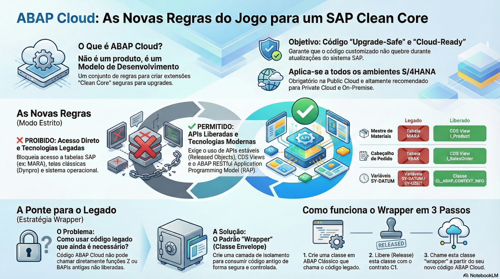

# Introdução ao SAP S/4HANA Cloud, Extensões e Clean Core

> **Comece pelos slides: [SAP S/4HANA Cloud, extensões e Clean Core](./04.01_SAP_S4HANA_Cloud_extensões_e_Clean_Core.pptx)**
>
> Material complementar em PDF: [A Nova Era da Extensibilidade SAP](./04.01_SAP_Clean_Core_A_Nova_Extensibilidade.pdf)
>
> **Referência oficial (ABAP Keyword Documentation):** [ABAP Cloud](https://help.sap.com/docs/abap-cloud/abap-keywords/abap-cloud)

## Objetivos de Aprendizagem

- Definir com precisão o conceito de **Clean Core** e articular por que ele é o pilar fundamental para garantir a agilidade de inovação e a segurança nos upgrades do S/4HANA.
 
- Diferenciar e selecionar a estratégia correta entre as três opções de extensibilidade: **Key User** (In-App), **On-Stack Developer** (Embedded Steampunk) e **Side-by-Side** (BTP).

- Compreender as restrições técnicas (Language Version 5) e os benefícios de arquitetura do modelo **ABAP Cloud** em comparação ao ABAP Clássico.

- Identificar as nuances de governança e implementação entre **S/4HANA Cloud Public Edition** (SaaS puro) e **Private Edition** (Flexível), aplicando os princípios de Clean Core em ambos os cenários.

- Descrever como a SAP recomenda tratar o código customizado em uma conversão: coletar uso, eliminar o que não é usado e adaptar o restante.

## 1. O Problema: O "Spaghetti" do Passado e a Dívida Técnica

No mundo do *SAP ECC (On-Premise)* tradicional, a flexibilidade era uma faca de dois gumes. Os clientes tinham poder total para modificar o sistema, mas isso gerou uma enorme dívida técnica ao longo das décadas.

### Exemplos Clássicos de Más Práticas (O "Legado")

* **Modificações no Core:** Uso de *Access Keys* para alterar diretamente o código fonte de programas standard da SAP (ex: `MV45AFZZ`). Isso significa que a lógica da SAP e a lógica do cliente estavam entrelaçadas.

* **Estruturas de Dados Invasivas:** Uso indiscriminado de `APPEND STRUCTURE` em tabelas padrão críticas como `VBAK` ou `MARA`, muitas vezes sem prefixos ou namespaces adequados, causando conflitos de nomes em atualizações.

* **Uso de APIs Não Estáveis:** Chamadas diretas a Módulos de Função internos (que não eram BAPIs oficiais) ou leituras diretas em tabelas de configuração do sistema (`T001`). Quando a SAP mudava a estrutura interna dessas tabelas em um upgrade, o código do cliente parava de funcionar.

* **A Consequência (O Pesadelo do Upgrade):** Projetos de upgrade de versão (ex: `EHP7` para `EHP8`) tornaram-se eventos traumáticos, caros e demorados (meses ou anos). As fases de `SPDD` (Ajuste de Dicionário) e `SPAU` (Ajuste de Repositório) exigiam exércitos de consultores para analisar e "consertar" o código quebrado.

* *Resultado:* As empresas paravam de atualizar seus sistemas por medo, ficando presas em versões obsoletas e perdendo inovações. Na era da nuvem, onde atualizações ocorrem trimestralmente, esse modelo é insustentável.

## 2. A Solução: Estratégia Clean Core

O princípio **Clean Core** (Núcleo Limpo) é a resposta da SAP para eliminar esse ciclo vicioso. A ideia central é simples: o código padrão da SAP (o Core) deve permanecer intocado, tratado como uma "Caixa Preta" selada.

**Os 3 Pilares do Clean Core:**

1. **Nenhuma Modificação Direta:** É estritamente proibido alterar objetos standard. As antigas "User Exits" e modificações de código fonte são substituídas por pontos de extensão formais e estáveis.
 
2. **Uso Exclusivo de APIs Públicas:** O código customizado só pode interagir com o sistema SAP através de **Released APIs** (Whitelisted). Isso inclui CDS Views liberadas, BAdIs Cloud e Classes utilitárias marcadas como estáveis (Contrato C1). Se a SAP mudar o funcionamento interno, a API pública permanece estável, garantindo que sua extensão não quebre.

3. **Separação Física ou Lógica:** As customizações devem estar claramente separadas do código standard, seja rodando em uma plataforma externa (Side-by-Side) ou em um ambiente isolado dentro do stack (ABAP Cloud).

## 3. As 3 Opções de Extensibilidade

Para viabilizar o Clean Core sem perder a capacidade de adaptar o ERP às necessidades específicas do negócio, a SAP definiu três formas oficiais de extensão:

> **Atenção à nomenclatura:** não confunda estas três *opções* de extensibilidade com o **Modelo de 3 Tiers** (Tier 1 = ABAP Cloud, Tier 2 = Cloud API Enablement, Tier 3 = ABAP Clássico), que descreve os níveis de desenvolvimento ABAP no Private Edition/On-Premise e é apresentado na seção 5.

### Opção 1: Key User Extensibility (In-App)

* **Público-Alvo:** Consultores Funcionais, "Key Users" avançados e Cidadãos Desenvolvedores (Low-Code/No-Code).

* **O que permite:** Pequenas adaptações na UI sem necessidade de projeto de desenvolvimento TI.  
  
  * Adicionar campos personalizados a telas e relatórios (que persistem até o banco de dados).  
  
  * Alterar o layout de formulários e emails.  
  
  * Criar lógicas de validação simples usando BAdIs restritas baseadas em web.
  
* **Ferramenta:** Apps Fiori nativos como "Custom Fields and Logic" direto no navegador.

### Opção 2: Developer Extensibility (On-Stack / Embedded Steampunk)

* **Público-Alvo:** Desenvolvedores ABAP Profissionais.  

* **O que permite:** Desenvolvimento de aplicações complexas e lógica pesada que precisa rodar **dentro** do S/4HANA para performance máxima (acesso local aos dados).  
  
  * Criação de novas Tabelas Z, Classes Globais, CDS Views complexas e Serviços OData (RAP).  
  
  * Implementação de BAdIs de lógica de negócio complexa.  

* **A "Pegadinha" (Restrição):** Embora seja ABAP, não é o ABAP antigo. O desenvolvimento é restrito ao modelo **ABAP Cloud**. Você não tem acesso ao SAP GUI, não pode acessar arquivos do sistema operacional e só pode usar objetos liberados.

### Opção 3: Side-by-Side Extensibility (SAP BTP)

* **Público-Alvo:** Desenvolvedores Full-Stack (Java, Node.js, ABAP) e Arquitetos de Solução.  

* **O que permite:** Construir aplicações totalmente **desacopladas** do ERP, rodando na **SAP Business Technology Platform (BTP)**.  

* **Cenários Ideais:**  
  
  * Integração com serviços de Inteligência Artificial (AI Core) e Machine Learning.  
  
  * Desenvolvimento de Apps Móveis nativos (iOS/Android).  
  
  * Portais externos para fornecedores ou clientes (B2B/B2C).  
  
  * Integração com sistemas de terceiros.  

* **Comunicação:** O App no BTP conversa com o S/4HANA exclusivamente via APIs públicas (OData, SOAP) ou Eventos (Event Mesh).

## 4. ABAP Cloud: O Novo Padrão de Desenvolvimento

O termo "ABAP Cloud" não se refere a um produto que você compra, mas sim a um **Modelo de Desenvolvimento** e Governança. Ele é o padrão *de facto* para o S/4HANA Public Cloud e a recomendação forte para o Private Cloud/On-Premise a partir da versão 2022.

**Pilares Técnicos do ABAP Cloud:**

1. **Core Data Services (CDS):** O modelo de dados é definido exclusivamente via CDS, abandonando a criação de Views na `SE11`.
 
2. **RAP (ABAP RESTful Application Programming Model):** O modelo transacional único para criar serviços e aplicações Fiori.

3. **Released Objects (Whitelisting):** O compilador verifica cada objeto que você usa. Tentar fazer um `SELECT * FROM MARA` resultará em erro de sintaxe, pois `MARA` não é liberada. Você deve usar a interface pública `I_Product`.  

4. **ADT (Eclipse):** A única ferramenta permitida. O SAP GUI é obsoleto para desenvolvimento neste modelo.  

5. **Language Version 5:** Uma configuração técnica no compilador ABAP que desativa comandos legados (como `CALL SCREEN`, `WRITE`, `SUBMIT REPORT`) e impõe o uso de sintaxe moderna e segura.

## 5. Public vs. Private Edition: Nuances de Adoção

* **S/4HANA Cloud Public Edition:** É um SaaS (Software as a Service) puro, multi-tenant.  
  
  * **Governança:** A infraestrutura é gerenciada pela SAP.  
  
  * **Rigidez:** O Clean Core é **tecnicamente imposto**. Você *não consegue* modificar o código standard ou usar ABAP Clássico, mesmo que queira. Apenas extensibilidade Key User e ABAP Cloud são permitidas.  
  
  * **Upgrades:** Automáticos e obrigatórios.

* **S/4HANA Cloud Private Edition:** É um ambiente dedicado (single-tenant), oferecendo controle total similar ao On-Premise.
  
  * **Governança:** O cliente tem mais controle sobre a janela de upgrades.  
  
  * **Flexibilidade:** Você tem acesso técnico ao SAP GUI e ao código legado (ABAP Clássico).  
  
  * **O Modelo de 3 Tiers:** Para organizar o desenvolvimento ABAP nesse cenário, a SAP definiu:  
    * **Tier 1 — ABAP Cloud:** O caminho preferido e à prova de upgrades, para todo novo desenvolvimento. Usa apenas APIs liberadas.  
    * **Tier 2 — Cloud API Enablement:** A "ponte". Wrappers que encapsulam objetos SAP ou código Z ainda não liberados e os liberam (C1) para consumo no Tier 1.  
    * **Tier 3 — ABAP Clássico:** Código legado e extensões que não são possíveis no Tier 1. Fortemente acoplado ao sistema; recomendado apenas como último recurso.  
  
  * **O Desafio:** A SAP recomenda fortemente seguir o Clean Core (Tier 1, com Tier 2 como ponte) para garantir "Cloud Readiness". No entanto, é permitido usar código legado (Tier 3) para facilitar migrações (Brownfield), com o entendimento de que isso gera dívida técnica para o futuro.

> **Evolução recente (2025):** a SAP aposentou o modelo de 3 Tiers em favor dos **Clean Core Levels**: **A** (APIs liberadas, máxima estabilidade em upgrades), **B** (APIs e tecnologias clássicas), **C** (acesso a objetos internos, com riscos gerenciáveis) e **D** (objetos/técnicas não recomendados, como modificações — maior risco e dívida técnica). Os princípios deste módulo continuam válidos; muda a forma de classificar as extensões (detalhes e configuração do sistema na lição 04.05).

## 6. Preparando o Código Legado para o S/4HANA

Em uma conversão, boa parte das extensões antigas deixa de ser necessária: o S/4HANA traz novos modelos de dados, novas aplicações e funcionalidades que antes exigiam código Z. A SAP recomenda tratar o código customizado em etapas:

1. **Coletar o uso real:** Use o **ABAP Call Monitor** (`SCMON`) ou o *Usage and Procedure Logging* (UPL), um ou outro, **no sistema produtivo**, por 6 a 18 meses, incluindo pelo menos um fechamento anual. A transação `SUSG` agrega esses dados, que o `SCMON` apaga depois de pouco tempo.

2. **Identificar o que pode sair:** O app SAP Fiori **Custom Code Migration** (em um sandbox S/4HANA ou na SAP BTP, ABAP environment) ou o ATC cruzam a análise do código com os dados de uso e apontam extensões não usadas.

3. **Guardar antes de apagar:** Defina um procedimento de backup e restauração, por exemplo com o gCTS (Git-enabled Change and Transport System).

4. **Remover na conversão** o que não é usado e **adaptar** o restante: automaticamente, com os *Quick Fixes* do ATC; ou manualmente, guiado pelas SAP Notes listadas pelo **SAP Readiness Check**.

> Converter o sistema (Brownfield) ou implementar do zero (Greenfield) muda o tamanho desse trabalho. A comparação está na lição 04.05.

## Diagrama de Decisão: Onde desenvolver minha extensão?

1. **É uma mudança simples de campo, layout ou texto?**  
   * Sim -> **Key User Extensibility**. Rápido, barato, sem código.  

2. **A lógica exige acesso intensivo a dados do ERP e alta performance (ex: validação complexa de transação)?**  
   * Sim -> **On-Stack ABAP Cloud (Developer Extensibility)**. Evita latência de rede, mantém os dados no lugar.  

3. **Preciso integrar com serviços de IA, Mobile, ou criar um portal externo para parceiros?**  
   * Sim -> **Side-by-Side BTP**. Desacopla o ciclo de vida, usa tecnologias abertas.

## Glossário Técnico

* **Clean Core:** Estratégia arquitetural que visa manter o núcleo do ERP livre de modificações diretas, utilizando apenas pontos de extensão estáveis e APIs públicas para garantir que o sistema seja "atualizável" (upgrade-safe) e ágil.  

* **Key User Extensibility:** Conjunto de ferramentas Low-Code embutidas no Fiori Launchpad que empoderam usuários funcionais a adaptar a UI, adicionar campos e lógica simples sem envolver desenvolvedores.  

* **Developer Extensibility (On-Stack):** Modelo de desenvolvimento ABAP feito diretamente no ambiente S/4HANA ("Embedded Steampunk"), restrito às regras do ABAP Cloud para garantir segurança e estabilidade, mas com acesso performático aos dados locais.  

* **Side-by-Side Extensibility:** Modelo de desenvolvimento desacoplado na plataforma SAP BTP. Ideal para inovação, integração com tecnologias não-ABAP e cenários que exigem escalabilidade elástica independente do ERP.  

* **Released API (Whitelisted API):** Subconjunto de objetos SAP (CDS Views, Classes, BAdIs) que possuem um contrato de estabilidade garantido (C1). O desenvolvimento Clean Core só pode referenciar estes objetos para evitar quebras em upgrades.  

* **ABAP Language Version 5:** Configuração do compilador ("ABAP for Cloud Development") que restringe a sintaxe da linguagem, proibindo comandos legados e acesso não autorizado ao sistema.

## Quiz de Fixação

1. Por que a estratégia "Clean Core" é considerada um pré-requisito essencial para o sucesso no SAP S/4HANA Cloud?  
  R: Porque na nuvem os upgrades de software são automáticos e frequentes (trimestrais ou semestrais). Se houver modificações diretas no código padrão (como era comum no ECC), o processo de upgrade quebrará as customizações, causando paradas no negócio e exigindo projetos de correção caros e demorados. O Clean Core garante que as extensões sobrevivam aos upgrades sem impacto.  

2. Um desenvolvedor ABAP experiente precisa criar uma nova tabela Z e uma lógica complexa de validação que acessa múltiplas tabelas do ERP para um relatório crítico. Ele quer manter o Clean Core, mas precisa de performance local. Qual modelo de extensibilidade é o mais indicado?  
  R: Developer Extensibility (On-Stack). Esse modelo permite criar tabelas customizadas e lógica ABAP complexa dentro do S/4HANA, aproveitando a proximidade dos dados para performance, mas utilizando a sintaxe segura do ABAP Cloud e objetos liberados para garantir a compatibilidade futura.  

3. No modelo ABAP Cloud (Developer Extensibility), posso fazer um SELECT direto na tabela KNA1 (Mestre de Clientes) para ler o endereço de um cliente?  
  R: Não (ou não deveria). A tabela física KNA1 não é um objeto liberado (Released Object) no modelo ABAP Cloud e seu uso pode ser bloqueado pelo compilador ou checagens de sintaxe (ATC). A prática correta é selecionar a partir da CDS View pública equivalente (ex: I_Customer), que é a interface estável garantida pela SAP para acesso a esses dados.
