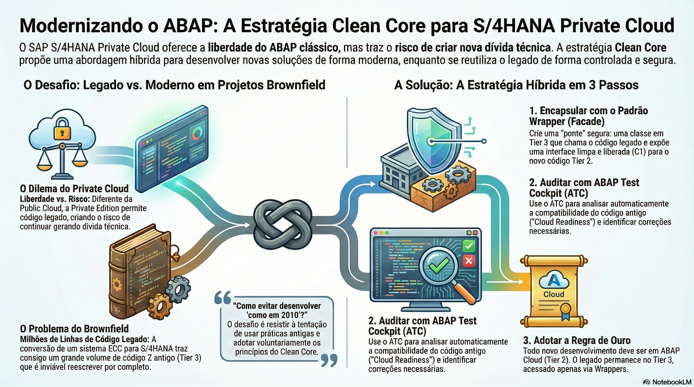

# Considerações Especiais para SAP S/4HANA Cloud Private Edition e On-Premise



> **Comece pelos slides: [Clean Core no Private Edition e on-premise](./04.05_Clean_Core_no_Private_Edition_e_on-premise.pptx)**
>
> Material complementar em PDF: [Dominando os Dois Mundos: A Estratégia Clean Core Definitiva para SAP S/4HANA Private Cloud e On-Premise](./04.05_Dominando_os_Dois_Mundos_Estratégia_Clean_Core.pdf)
>
> **Referência oficial (ABAP Keyword Documentation):** [ABAP Test Cockpit](https://help.sap.com/docs/abap-cloud/abap-keywords/abap-test-cockpit)

## Objetivos de Aprendizagem

- Diferenciar estrategicamente as abordagens de implementação **Greenfield** (Novo) vs **Brownfield** (Migração), identificando os desafios técnicos e de dívida técnica inerentes a cada cenário.  

- Aplicar o padrão de projeto **Wrapper (Facade)** para encapsular código legado (Tier 3) dentro de interfaces modernas e liberadas, permitindo sua reutilização segura em desenvolvimentos Clean Core (Tier 1).  

- Utilizar o **ABAP Test Cockpit (ATC)** com variantes de verificação específicas para auditar a "Cloud Readiness" de código antigo, interpretando resultados e aplicando correções automáticas (Quick Fixes).  

- Arquitetar a convivência híbrida entre o modelo **Tier 1 (Cloud)** e **Tier 3 (Classic)** no mesmo sistema Private Cloud, estabelecendo fronteiras claras para evitar a contaminação do novo código.

- Aplicar os **níveis A–D do Clean Core** e preparar o sistema (componentes de software, autorizações e ATC) para desenvolver por nível.

## 1. O Dilema: Public vs Private Edition

A escolha da edição do S/4HANA define as regras do jogo para o desenvolvedor.

* **S/4HANA Cloud Public Edition:** É um ambiente SaaS (Software as a Service) puro. A infraestrutura é compartilhada e gerenciada pela SAP.  
  
  * **Restrição:** O ABAP Clássico não existe aqui. Você não tem acesso ao SAP GUI, nem à `SE38`. O Clean Core é tecnicamente imposto; o compilador simplesmente não aceita código que viole as regras da nuvem. É Clean Core ou nada.  

* **S/4HANA Cloud Private Edition (e On-Premise):** É um ambiente dedicado (Single Tenant). Você tem controle total sobre o servidor.  
  
  * **Liberdade:** Você tem acesso total ao SAP GUI, transações antigas (`SE80`, `SM30`) e pode escrever código legado à vontade.  
  
  * **O Perigo:** A liberdade é tentadora. É muito fácil continuar desenvolvendo "como em 2010" (usando includes, acessando tabelas diretamente, modificando standard), gerando nova dívida técnica.  
  
  * **A Recomendação:** A SAP recomenda fortemente a **adoção voluntária** do Clean Core. Trate novos desenvolvimentos como se você estivesse na Public Cloud (Tier 1), e isole o legado estritamente no Tier 3. Isso garante que seu sistema esteja pronto para futuras inovações (IA, Side-by-Side) e upgrades tranquilos.

## 2. Migração: Greenfield vs Brownfield

A estratégia de desenvolvimento depende drasticamente de como você chegou ao S/4HANA.

### Greenfield (Começar do Zero)

Neste cenário, a empresa implementa um sistema novo, sem carregar o histórico técnico do passado.

* **Estratégia:** É a oportunidade perfeita para aplicar Clean Core 100%. Todos os novos desenvolvimentos devem nascer no **Tier 1 (ABAP Cloud / On-Stack Developer Extensibility)** ou usar **Key User Extensibility**.  
* **Vantagem:** Arquitetura limpa, sem dependências legadas, total compatibilidade com upgrades futuros.

### Brownfield (Conversão de Sistema)

Neste cenário, a empresa converte seu antigo ECC para S/4HANA, trazendo consigo terabytes de dados e milhões de linhas de código Z (customizações) escritas nos últimos 20 anos.

* **O Desafio:** A maior parte desse código Z reside no **Tier 3 (Classic Extensibility)**. Ele continua funcionando, mas impede a agilidade. Reescrever tudo para Tier 1 seria economicamente inviável.  

* **Estratégia Híbrida:**  
  1. **Mantenha o Legado Estável:** Deixe o código antigo funcionando no Tier 3. Não refatore o que não precisa ser mudado ("If it ain't broke, don't fix it").  
  
  2. **Novas Funcionalidades no Tier 1:** Qualquer novo requisito (um novo App Fiori, uma nova API) deve ser construído usando RAP e ABAP Cloud (Tier 1).  
  
  3. **A Ponte:** Quando o novo (Tier 1) precisar acessar o velho (Tier 3), use Wrappers (Tier 2 - Cloud API Enablement).

## 3. A Técnica do Wrapper (A Ponte entre Mundos)

Este é o padrão de design mais importante para projetos Brownfield.

**Cenário:** Você está criando um App Fiori moderno (Tier 1 - ABAP Cloud) para criar Pedidos. Porém, sua empresa tem uma função Z antiga e complexa (`Z_CALCULA_IMPOSTO_BR_COMPLEXO`) que tem 5.000 linhas de código, acessa tabelas customizadas e funciona perfeitamente.

**Problema:** Você não pode chamar essa função diretamente do Tier 1 se ela não estiver marcada como "Released". E você não pode "liberar" uma função procedural antiga cheia de código não-compliant.

### Solução: O Wrapper (Padrão Facade)

1. **Crie a Classe Wrapper (No Tier 2 - Cloud API Enablement, em ABAP Clássico):** Crie uma Classe Global (`ZCL_WRAPPER_IMPOSTO`) no modo Standard ABAP. Como ela é escrita em ABAP Clássico, ela tem "superpoderes": pode chamar a função antiga, ler tabelas diretas, etc.  

2. **Implementação Limpa:** Dentro do método desta classe, chame a função antiga, trate os dados e retorne em formatos limpos.  

3. **Liberação (Release C1):** Aqui está o segredo. Você marca esta classe Wrapper com o contrato *C1 (Use in Cloud Development)*. Ao fazer isso, você está dizendo ao compilador do _Tier 1: "Eu garanto que esta classe é segura e estável para ser chamada"_.  

4. **Consumo (No Tier 1 - Cloud ABAP):** Seu novo App Fiori agora pode instanciar `ZCL_WRAPPER_IMPOSTO` e chamar o método.

O Wrapper atua como uma "zona de descontaminação" ou adaptador, expondo uma interface limpa e moderna para o código novo, enquanto esconde a complexidade e a "sujeira" do legado no backend.

## 4. ATC: Medindo a "Cloud Readiness"

Como saber se seu código Z antigo vai funcionar na nuvem ou se ele precisa de ajustes? A análise manual de milhões de linhas é impossível.

O **ABAP Test Cockpit (ATC)** é a ferramenta de governança automatizada. Ele possui variantes de verificação específicas para este fim:

* **ABAP_CLOUD_READINESS:** Verifica se o código está "pronto para ABAP Cloud": apenas tipos de objeto e instruções permitidos no ABAP Cloud e apenas APIs SAP liberadas. Gera uma lista de findings, muitos com *Quick Fix*.  

* **ABAP_CLOUD_DEVELOPMENT_DEFAULT:** Garante as regras básicas do ABAP Cloud no código **novo**.  

* **S4HANA_READINESS:** Verifica incompatibilidades funcionais e de banco de dados (ex: uso de tabelas que deixaram de existir no S/4HANA, como a MATC ou tabelas agregadas de FI).

### Fluxo de Trabalho de Migração:

1. **Auditoria:** Rodar o ATC em massa sobre todo o pacote de código legado (Z*).  
2. **Triagem:** Classificar os erros.  
   * *Erros Funcionais:* Devem ser corrigidos imediatamente (ex: `SELECT` em tabela que não existe mais).  
   * *Erros de Cloud:* Podem ser tolerados no Tier 3 (Private Cloud), mas devem ser corrigidos se o objetivo for migrar esse código para o Tier 1.  
3. **Correção:** Utilizar *Quick Fixes* no Eclipse para modernizar sintaxe (ex: adicionar `ORDER BY` em SELECTs que dependiam da ordenação implícita do banco antigo).  
4. **Decisão Arquitetural:** Manter no Clássico (Tier 3), refatorar para ABAP Cloud (Tier 1) ou expor via Wrapper (Tier 2)?

## 5. Diagrama de Arquitetura Híbrida (Private Cloud)

Visualizando a convivência pacífica entre o novo e o velho:

```
    [ APP FIORI / RAP (Tier 1 - ABAP Cloud) ]  
    |  (Código Estrito, Syntax Check v5)  
    |  
    |  --> Chama apenas objetos marcados como "Released C1"  
    v  
    [ WRAPPER CLASS (Tier 2 - Marcado como C1) ]  
    |  (Atua como Fachada/Facade)  
    |  (Implementado em ABAP Standard, sem restrições)  
    |  
    |  --> Pode chamar qualquer coisa (BAPIs, Funções Z, Tabelas)  
    v  
    [ CÓDIGO LEGADO / BAPIS NÃO LIBERADAS (Tier 3) ]  
        (O "Core Sujo" ou Legado Complexo)
```

## 6. Dos 3 Tiers aos Níveis A–D do Clean Core

Em 2025 a SAP evoluiu o modelo de 3 Tiers para o **conceito de níveis de Clean Core**. A mudança principal: o ABAP clássico deixa de ser tratado inteiro como "sujo". Cada extensão é avaliada pelo risco dos objetos SAP que usa.

| Nível | Usa | Risco em upgrades |
| :--- | :--- | :--- |
| **A** | **Released APIs** e pontos de extensão liberados (ABAP Cloud, Key User, side-by-side na BTP) | Mínimo (equivale ao antigo Tier 1) |
| **B** | **Classic APIs**: artefatos clássicos (ex.: BAPIs) que a SAP classifica como estáveis | Baixo |
| **C** | **Objetos internos**, não classificados como API | Gerenciável, acompanhado pelo changelog da SAP |
| **D** | **Objetos não recomendados**: modificações, escrita direta em tabelas SAP, enhancements implícitos | Alto: remediar |

* **A extensão vale o seu pior objeto:** Ela é classificada pelo objeto de **menor** nível que usa.

* **Nada se perde:** Wrappers construídos no modelo de Tiers (Tier 2) **não precisam ser migrados**. O objetivo é subir de nível sempre que possível.

## 7. Preparando o Sistema para Desenvolvimento por Níveis

1. **Componentes de software:** Com o report `RSMAINTAIN_SWCOMPONENTS` (a partir do ABAP Platform 2022), crie componentes do tipo **ABAP Cloud** (nível A: tudo dentro deles segue o ABAP Cloud) ou **ABAP Classic** (níveis B a D). Abaixo de cada um, um *structure package* e os pacotes de desenvolvimento.

2. **Autorizações:** O objeto `S_ABPLNGVS` (ativado via `SACF`) restringe a *language version* que cada desenvolvedor pode usar. Por exemplo, um papel copiado de `SAP_BC_ABAP_DEVELOPER_5` limita a equipe ao nível A.

3. **ATC:** Use as variantes da seção 4 e, se quiser medir os níveis, uma variante própria de **Clean Core**, cujos findings seguem a escala: nível A sem finding, B como informação (prioridade 3), C como aviso (prioridade 2) e D como erro (prioridade 1).

## Estratégia de 3 Passos para Clean Core no Private Cloud

1. **Novos Projetos:** Tornar obrigatório o uso de **ABAP Cloud (Tier 1)** para qualquer novo desenvolvimento (ex: novos relatórios, novos apps Fiori).  
2. **Extensões de Padrão:** Sempre que possível, usar **Key User Extensibility** para campos simples ou **Cloud BAdIs** para lógica de processo. Evitar User Exits antigas.  
3. **Legado Crítico:** Para lógicas antigas que precisam ser reutilizadas no novo mundo, **Encapsular em Wrappers** e consumir no Tier 1, em vez de reescrever ou duplicar a lógica.

## Glossário Técnico

* **Greenfield:** Abordagem de implementação onde o sistema SAP é instalado do zero ("campo verde"), sem migração de dados históricos ou código legado. É o cenário ideal para adotar a estratégia Clean Core em 100% dos desenvolvimentos desde o primeiro dia.  

* **Brownfield:** Abordagem de implementação onde um sistema ECC existente é convertido tecnicamente para S/4HANA. Preserva dados e código Z, mas herda a dívida técnica. Exige uma gestão cuidadosa de convivência entre o modelo Clássico e o modelo Cloud.  

* **Wrapper Pattern (Padrão Envelope):** Padrão de design estrutural onde uma classe (escrita em ABAP Clássico, formando o Tier 2 - Cloud API Enablement) encapsula lógica legada, complexa ou não-liberada e expõe uma interface simplificada, estável e liberada (Contrato C1) para consumo por aplicações modernas (Tier 1).  

* **Cloud Readiness:** O grau de conformidade de um código customizado com as regras e restrições do ABAP Cloud (uso de APIs liberadas, sem acesso ao SO, sintaxe moderna). É verificado automaticamente via ATC.  

* **Níveis A–D do Clean Core:** Classificação de 2025 que sucede os 3 Tiers: A = APIs liberadas, B = APIs clássicas, C = objetos internos, D = não recomendado.  

* **Tier 3 (Classic Extensibility):** Camada de extensibilidade disponível apenas no Private Edition/On-Premise que permite o desenvolvimento ABAP tradicional (não restrito). Deve ser evitada para novos projetos, servindo apenas como repositório de legado (os Wrappers liberados formam o Tier 2).

## Quiz de Fixação

1. No S/4HANA Private Cloud, por que eu deveria me preocupar em usar ABAP Cloud (Tier 1) se eu tenho acesso total à `SE38` e ao modo clássico (Tier 3)?  
  R: Para garantir a "Upgradeability" (facilidade de atualização) e a longevidade do código. Código escrito no Tier 3, embora funcione hoje, pode quebrar em futuros upgrades da SAP (pois usa APIs internas instáveis) ou dificultar uma futura migração para a Public Cloud. O código no Tier 1 usa apenas APIs estáveis garantidas pela SAP, blindando a extensão contra mudanças no núcleo.  

2. Tenho uma BAPI padrão da SAP que não está na lista de "Released Objects" (Whitelist), mas preciso muito usá-la no meu novo App Fiori RAP desenvolvido no Tier 1. Qual a solução arquitetural correta no Private Cloud?  
  R: Criar uma classe Wrapper em ABAP Clássico (Tier 2 - Cloud API Enablement) que chama essa BAPI internamente. Em seguida, deve-se liberar explicitamente (Release Contract C1) essa classe Wrapper para que ela se torne visível e consumível pelo App Fiori no Tier 1.  

3. Qual ferramenta devo usar para analisar em massa meu código Z legado e descobrir o que precisa ser ajustado para ser tecnicamente compatível com o banco de dados HANA e com as regras da nuvem?  
  R: O ABAP Test Cockpit (ATC) com as variantes de verificação globais de prontidão para S/4HANA (S4HANA_READINESS) ou prontidão para ABAP Cloud (ABAP_CLOUD_READINESS), que apontam usos de objetos obsoletos e violações de regras.
