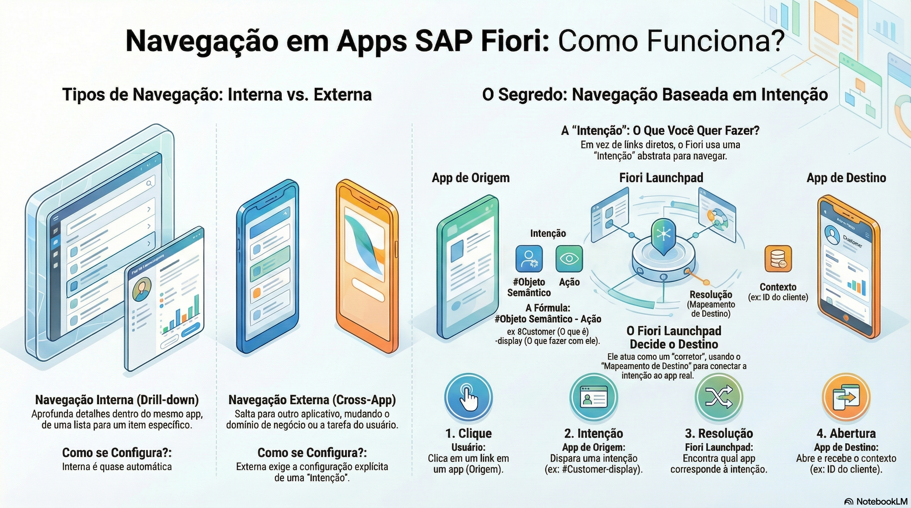

# Visão Geral do Conceito de Navegação em Apps SAP Fiori Elements



> **Comece pelos slides: [Navegação em apps Fiori elements](./05.08_Navegação_em_apps_Fiori_elements.pptx)**
>
> Material complementar em PDF: [Navegação Inteligente em SAP Fiori Elements](./05.08_Navegação_Inteligente_SAP_Fiori_Elements_Guia_Definitivo.pdf)
## Objetivos de Aprendizagem

- Diferenciar com precisão a **Navegação Interna** (Drill-down), que aprofunda o contexto dentro do mesmo objeto, da **Navegação Externa** (Cross-App), que transfere o contexto para um domínio de negócio diferente.  

- Compreender a arquitetura de **Navegação Baseada em Intenção** (Intent-Based Navigation), explicando como o Fiori Launchpad atua como um "broker" para resolver links dinamicamente.  

- Identificar e aplicar os componentes de uma Intenção: **Semantic Object** (O que é) e **Action** (O que fazer), construindo hashtags de navegação válidas.  

- Configurar links de navegação inteligentes em tabelas usando a anotação `#FOR_INTENT_BASED_NAVIGATION`, garantindo a passagem correta de parâmetros de contexto.

## 1. Tipos de Navegação: O Fluxo do Usuário

No universo SAP Fiori, a navegação não é apenas "clicar num link para mudar de página". É um conceito projetado para suportar o fluxo de pensamento do usuário. Existem dois mecanismos distintos que servem a propósitos diferentes:

### A. Navegação Interna (Drill-down)

Este é o padrão hierárquico. O usuário começa em uma visão ampla e mergulha nos detalhes.

* **Cenário:** Você está na lista de todos os pedidos (List Report) do app Pedidos de Compras. Você clica no Pedido 0000000100. O sistema abre a página de detalhes desse pedido (Object Page). Dentro dela, você clica num item da tabela de Itens e vê os detalhes do item (Sub-Object Page).  

* **Configuração:** É praticamente **Automática**. Se você definiu as facetas e associações corretamente nas suas CDS Views e Metadata Extensions, o Fiori Elements "sabe" que a entidade Pedido tem uma relação com ItemPedido (a composição `_Itens`) e cria os links de navegação interna sozinho. O contexto (ID do pedido) é preservado na URL interna do app.

### B. Navegação Externa (Cross-App)

Este é o poder do ecossistema integrado. É quando o usuário muda de "papel" ou de "domínio".

* **Cenário:** Você está no app **Pedidos de Compras**. Você vê que o pedido é da cliente "Ana Souza" e quer conferir os endereços e o cadastro dela. Você clica no nome da cliente e é redirecionado para o app **Gestão de Clientes** (um aplicativo totalmente diferente, com outro serviço OData).  

* **Configuração:** Requer configuração explícita de **Objeto Semântico**. Você precisa dizer ao sistema: "Este campo não é apenas um texto 'Ana Souza'; ele representa a entidade de negócio 'Cliente'". No projeto [Pedidos de Compras](https://github.com/AdrianoBispo/sap-abap-rap-pedidos-de-compras-app), esse objeto semântico se chama `ZPCCliente`.

## 2. O Segredo: Intent-Based Navigation (Navegação Baseada em Intenção)

O SAP Fiori Launchpad resolve um problema antigo da web: links quebrados. Ele não usa URLs fixas e duras (como `www.sap.com/app/vendas.html`). Em vez disso, ele usa um sistema abstrato chamado **Intenções**.

Uma intenção é formada por duas partes principais, separadas por um hífen, precedidas por uma hashtag: `#ObjetoSemântico-Ação ` 

A Filosofia: O aplicativo de origem não diz "Abra o aplicativo Z_APP_CLIENTE". Ele diz "Eu tenho a intenção de Exibir um Cliente". O Launchpad intercepta esse pedido e decide qual aplicativo abrir.  

**Exemplos de Intenções Reais:**

* `#SalesOrder-display`: O usuário quer ver detalhes de um pedido de venda. (Pode abrir o App Fiori padrão de Vendas).  
* `#ZPCCliente-manage`: O usuário quer gerenciar um cliente. (No projeto, abre o app Gestão de Clientes).  
* `#ZPCAnalisePedido-display`: O usuário quer ver gráficos. (No projeto, abre o app Análise de Pedidos de Compras).

Como funciona (Target Mapping): No Launchpad Designer (ou Content Manager), o administrador cria um Target Mapping (Mapeamento de Destino).

* *Regra:* Se alguém chamar `#ZPCCliente-manage`...  
* *Ação:* ... abra o aplicativo BSP da Gestão de Clientes.

Isso desacopla os apps. Se amanhã você trocar o app de clientes antigo por um novo, você só muda o Target Mapping. Todos os links em todos os apps do sistema continuam funcionando e agora apontam para o novo app automaticamente.

## 3. Configurando Navegação na Tabela

Para transformar uma coluna simples (ex: `NomeCliente`) em um botão que leva a outro aplicativo, usamos o tipo de linha `#FOR_INTENT_BASED_NAVIGATION` na anotação `@UI.lineItem`.

### Sintaxe na Metadata Extension:

``` CDS
@UI.lineItem: [   
  {   
    position: 30,   
    label: 'Cliente',  
      
    /* Define que esta coluna é um link de navegação */  
    type: #FOR_INTENT_BASED_NAVIGATION,   
      
    /* O "Substantivo": Sobre qual objeto de negócio estamos falando? */  
    semanticObject: 'ZPCCliente',      
      
    /* O "Verbo": O que queremos fazer com ele? (display, edit, manage) */  
    semanticObjectAction: 'manage'   
  }   
]  
ClienteUUID;
```

### O Fluxo de Execução:

1. **Renderização:** O Fiori Elements detecta a anotação e desenha a navegação para o cliente.  
2. **Clique:** Quando o usuário clica, o framework dispara a intenção #ZPCCliente-manage.  
3. **Contexto:** O framework pega automaticamente os valores da linha clicada (ex: ClienteUUID) e os anexa à intenção.  
4. **Resolução:** O Launchpad recebe #ZPCCliente-manage?ClienteUUID=... e abre o aplicativo de destino, já no cliente certo.

## 4. Navegação com Mapeamento de Parâmetros

Um problema comum em integração é a divergência de nomes. No app de pedidos, o CPF do cliente se chama `CpfCliente`, mas o app de destino (Gestão de Clientes) identifica o cliente pelo campo `Cpf`, sua chave semântica. Se você apenas disparar a intenção, o destino não entenderá o parâmetro `CpfCliente`.

O Fiori Elements repassa os campos da linha como parâmetros usando os próprios nomes dos campos; se os nomes forem iguais aos esperados pelo destino, tudo funciona automaticamente. A anotação `@Consumption.semanticObject` marca o campo como representante de um Objeto Semântico (habilitando o Smart Link com os destinos disponíveis), mas **não renomeia** o parâmetro. Para isso existe `@Consumption.semanticObjectMapping`.

### Exemplo Completo com Mapeamento (projeção real do app de pedidos):

``` CDS
/* Na projeção ZC_PC_PEDIDO_APP:  
   @Consumption.semanticObject diz: "Ei, sistema, este campo   
   representa o Objeto Semântico 'ZPCCliente'", e o nome vira um Smart Link.  
   additionalBinding manda CpfCliente com o nome Cpf, que o destino entende.  
*/  
@Consumption.semanticObject: 'ZPCCliente'  
@Consumption.semanticObjectMapping.additionalBinding: [{ localElement: 'CpfCliente',  
                                                         element:      'Cpf' }]  
_Cliente.Nome as NomeCliente,

/* O mesmo par de anotações fica em ClienteUUID e em CpfCliente:  
   qualquer um dos três campos abre o cliente na Gestão de Clientes. */
```

*Nota:* O mapeamento também pode ser feito como anotação local no app (`Common.SemanticObjectMapping`, via SAP Fiori Tools) ou diretamente no Target Mapping do Launchpad.

## 5. Navegação para URL (Links da Web)

Às vezes, o destino não é um aplicativo SAP Fiori, mas uma página externa (Google, LinkedIn, Sistema Legado Web, Rastreamento de Correios). Para isso, usamos o tipo `#WITH_URL`.

Diferente da navegação baseada em intenção, aqui o link é "duro" (Hardcoded) ou vem de um campo de dados.

``` CDS
@UI.lineItem: [   
  {   
    type: #WITH_URL,   
    /* O valor da URL vem do conteúdo deste campo na view */  
    url: 'WebAddress',  
    label: 'Website'  
  }
]  
WebsiteLink;
```

### Cuidados:

* Links externos abrem em novas abas por padrão.  
* Não use `#WITH_URL` para navegar para outros apps SAP internos; você perderá a flexibilidade do Launchpad e a gestão de sessão.

### Fluxo da Navegação Externa (Passo a Passo)

1. **Usuário:** Clica no link "Ana Souza" na tabela de Pedidos.  
2. **App de Origem:** Dispara a intenção `#ZPCCliente-manage` e anexa o contexto, inclusive `?Cpf=52998224725` (graças ao mapeamento).  
3. **Fiori Launchpad:** Intercepta a intenção. Verifica nos catálogos do usuário qual _Target Mapping_ corresponde a `#ZPCCliente-manage`.  
4. **Resolução:** Encontra que essa intenção aponta para o app **Gestão de Clientes**.  
5. **App de Destino:** O Launchpad carrega a Gestão de Clientes e repassa o parâmetro `Cpf`. O app inicia já no cliente.

## Glossário Técnico

* **Intent-Based Navigation (Navegação Baseada em Intenção):** Mecanismo central de navegação do SAP Fiori Launchpad que desacopla a aplicação de origem da aplicação de destino. Em vez de links diretos, usa-se uma intenção semântica (#Object-Action), permitindo que o sistema resolva dinamicamente qual app abrir baseando-se nas permissões e configurações do usuário.  

* **Semantic Object (Objeto Semântico):** Representa uma entidade de negócio abstrata (ex: Customer, Product, SalesOrder, CostCenter; no projeto, `ZPCCliente` e `ZPCPedidoCompra`). É a primeira parte da hashtag de navegação e serve para agrupar todas as aplicações relacionadas a esse conceito.  

* **Semantic Action (Ação Semântica):** Representa a intenção do que se deseja fazer com o objeto (ex: display, edit, manage, approve, analyze). Diferentes ações no mesmo objeto podem levar a aplicativos completamente diferentes.  

* **Target Mapping (Mapeamento de Destino):** Configuração administrativa feita no Launchpad Designer que conecta uma Intenção (#Sales-display) a um aplicativo técnico real (Componente SAPUI5 ou Transação GUI). É a "tabela de roteamento" do Fiori.  

* **Drill-down:** Navegação vertical/hierárquica dentro do mesmo aplicativo, movendo-se de uma lista geral para uma visão detalhada (List Report -> Object Page), preservando o contexto da sessão.

## Quiz de Fixação

1. Qual a diferença fundamental de uso entre a anotação `#FOR_INTENT_BASED_NAVIGATION` e `#WITH_URL`?  
  R: `#FOR_INTENT_BASED_NAVIGATION` é usada para navegar para outros aplicativos Fiori dentro do ecossistema SAP/Launchpad usando abstrações semânticas (Objeto-Ação), garantindo integração e flexibilidade. `#WITH_URL` é usada para abrir links externos arbitrários da internet (como Google ou portais de parceiros) baseados em um endereço web absoluto.  

2. Se eu quiser que um clique no campo SalesOrderID abra o aplicativo padrão de exibição de pedidos de venda, quais informações obrigatórias preciso fornecer na anotação da linha?  
  R: Preciso fornecer o `type: #FOR_INTENT_BASED_NAVIGATION`, o semanticObject (ex: SalesOrder) e a semanticObjectAction (ex: display ou manage).

3. Como o aplicativo de destino sabe exatamente qual registro abrir quando o usuário clica em um link de navegação?
  R: O Fiori Elements (framework de origem) passa automaticamente os valores da linha selecionada (o contexto, como o ID) como parâmetros de URL na chamada da intenção. O aplicativo de destino é projetado para ler esses parâmetros de URL na sua inicialização (Startup Parameters) e usá-los para filtrar os dados ou carregar o registro específico.
