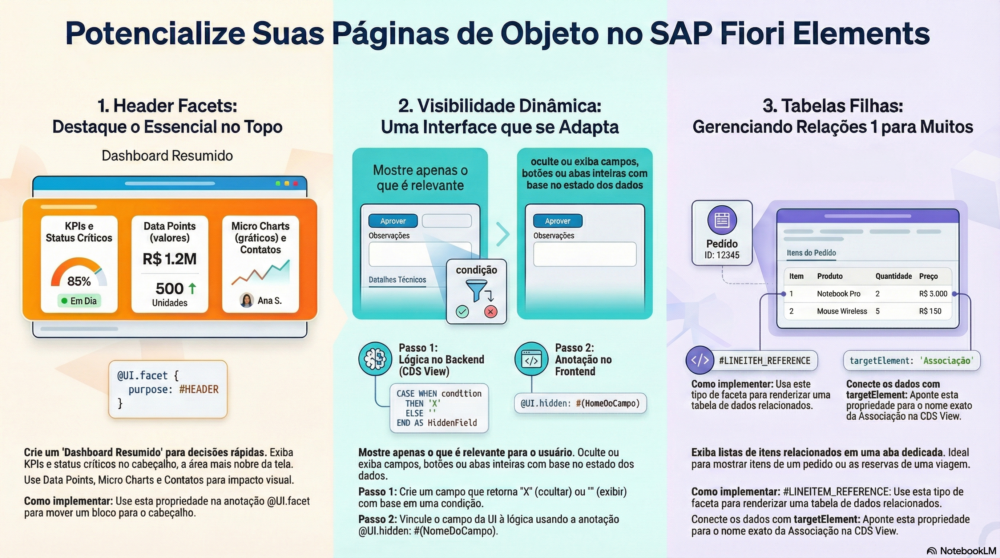

# Configurações Avançadas de Páginas de Objeto



> **Comece pelos slides: [Object Page avançada](./05.09_Object_Page_avançada.pptx)**
>
> Material complementar em PDF: [Construindo uma Object Page de Alta Performance](./05.09_De_Básico_a_Brilhante.pdf)
## Objetivos de Aprendizagem

- Configurar **Header Facets** para exibir informações críticas (KPIs, Status, Contatos) no cabeçalho colapsável da página, melhorando a capacidade de decisão rápida do usuário.  

- Aplicar **Visibilidade Dinâmica** (`@UI.hidden`) para mostrar ou ocultar campos, botões e facetas inteiras baseados em condições lógicas do backend, limpando a interface de elementos irrelevantes.  

- Entender e implementar o uso de **Sub-Seções** aninhadas para organizar formulários longos em blocos lógicos menores, evitando a fadiga de rolagem.  

- Identificar como referenciar Associações (`targetElement`) para criar abas que contêm **Tabelas Filhas** (Listas de Itens), permitindo a gestão de relacionamentos 1:N (Um para Muitos).

## 1. Header Facets: Destacando o Importante

A **Object Page** não se resume apenas ao corpo do formulário com abas. Uma das áreas mais valiosas e subutilizadas da tela é o **Header Content** (Conteúdo do Cabeçalho), a área retangular expansível localizada logo abaixo do título principal.

### Por que usar Header Facets?  

Em cenários de negócio complexos, o usuário muitas vezes precisa tomar uma decisão rápida (ex: "Aprovo ou Rejeito este orçamento?") sem ter que rolar por dezenas de campos de formulário. O Header Content serve como um Dashboard Resumido do objeto em foco. É o imóvel mais nobre da tela, reservado para KPIs (Key Performance Indicators), métricas críticas e status de alto nível.  

**Tipos de Conteúdo no Cabeçalho:** Embora possamos colocar grupos de campos simples, o cabeçalho brilha quando utilizamos visualizações semânticas ricas:

  * **Data Points:** Valores únicos exibidos com fonte grande e formatação de destaque (ex: Cores de criticidade, setas de tendência "Up/Down").  
  
  * **Micro Charts:** Pequenos gráficos (Bullet, Radial, Progress) que mostram a saúde do registro visualmente (ex: "% do Orçamento Utilizado").  
  
  * **Contact Details:** Cartões de visita com foto, nome e links diretos para e-mail/telefone (usando a anotação @Communication.contact).

* **Configuração Técnica:** Para posicionar um elemento nesta área, utilizamos a mesma anotação `@UI.facet` que usamos para o corpo da página, mas mudamos a propriedade purpose para `#HEADER`. O framework automaticamente entende que este bloco não pertence às abas de navegação (Anchor Bar), mas sim ao painel superior.  

``` CDS
@UI.facet: [  
  /* Faceta de Cabeçalho: Mostra o Valor Total no topo */  
  {  
    id: 'HeaderTotal',  
    purpose: #HEADER,            /* A Mágica acontece aqui: Move para o topo */  
    type: #DATAPOINT_REFERENCE,  /* Indica que vai renderizar um valor numérico formatado */  
    targetQualifier: 'ValorTotal', /* Aponta para a anotação @UI.dataPoint no campo */  
    position: 30  
  },  
    
  /* Faceta Padrão (Corpo da página) */  
  /* Se 'purpose' for omitido, assume-se #STANDARD */  
  {  
    id: 'DadosPedido',  
    purpose: #STANDARD,   
    type: #IDENTIFICATION_REFERENCE,  
    label: 'Dados do Pedido',  
    position: 20  
  }  
]
```

*Nota:* O uso de `#DATAPOINT_REFERENCE` no cabeçalho é a melhor prática para exibir valores monetários, pontuações ou contadores, pois permite aplicar cores semânticas (Verde/Vermelho) independentes da tabela. O app de pedidos do projeto [Pedidos de Compras](https://github.com/AdrianoBispo/sap-abap-rap-pedidos-de-compras-app) mostra três data points no cabeçalho: status do pedido, status do pagamento (ambos coloridos) e valor total.

## 2. Visibilidade Dinâmica (Hidden)

Um dos princípios do Fiori é a **Simplicidade**. Mostrar campos que não são relevantes para o contexto atual apenas confunde o usuário. Um requisito funcional comum é: *"A seção 'Cancelamento' (motivo, data e quem cancelou) só deve aparecer se o pedido estiver cancelado. Caso contrário, ela deve sumir."*

No **Fiori Elements**, não escrevemos `JavaScript` (`if status == 'X' show()`) para isso. Controlamos a visibilidade declarativamente apontando a propriedade hidden para um campo booleano.

### Passo 1: Lógica no Backend (CDS View)

Criamos um campo técnico (não exibido na tela) que retorna true quando o elemento alvo deve ser escondido. A forma mais direta é um campo calculado:

``` CDS
/* Na CDS View de pedidos */  
/* Lógica: Esconder se NÃO for Cancelado */  
cast( case when status_pedido = 'CANCELADO' then ' ' else 'X' end
      as abap_boolean preserving type ) as PedidoNaoCancelado,

/* Lógica: Esconder a seção de itens quando o pedido já foi encerrado */  
cast( case when status_pedido = 'FINALIZADO' or status_pedido = 'CANCELADO'
           then 'X' else ' ' end
      as abap_boolean preserving type ) as PedidoEncerrado
```

*Dica:* O `cast` para o elemento de dados `abap_boolean` faz o serviço OData V4 expor o campo como `Edm.Boolean`: `'X'` vira `true` (esconder) e o valor vazio vira `false` (não esconder). Sem esse cast, o campo seria um texto comum (`Edm.String`), e não um booleano.

> **Como o projeto faz:** em `ZR_PC_PEDIDO`, os indicadores `PedidoNaoCancelado`, `PedidoNaoFinalizado`, `PedidoEncerrado` e `PedidoAtivoSemHistorico` são **colunas físicas** da tabela, mantidas pela determination `AtualizarFlagsStatus` sempre que o status muda. No release usado, a projeção não repassava o `case` como booleano para o `hidden`, e a coluna física resolveu o problema.

### Passo 2: Anotação no Frontend (Metadata Extension)

Na Metadata Extension, vinculamos a propriedade `hidden` ao campo booleano usando a sintaxe `#(NomeDoCampo)`. Isso cria um "binding" dinâmico. No projeto, ele é usado na faceta inteira:

``` CDS
/* Seção Cancelamento: só aparece em pedidos cancelados */  
{ id: 'Cancelamento', purpose: #STANDARD, type: #FIELDGROUP_REFERENCE,  
  label: 'Cancelamento', position: 60, targetQualifier: 'Cancelamento',  
  /* Ocultação Dinâmica: o framework lê 'PedidoNaoCancelado' a cada leitura do pedido */  
  hidden: #(PedidoNaoCancelado) }
```

### Poder da Visibilidade:

* **Granularidade:** Isso funciona para **campos individuais**, para **ações** (botões) e até para **Facetas inteiras** (esconder uma seção inteira se não for relevante).  
* **Reatividade:** Se o status mudar na tela, a seção pode aparecer instantaneamente sem recarregar a página — desde que *Side Effects* estejam configurados para recarregar o campo de visibilidade quando o status mudar. No projeto, a action `CancelarPedido` devolve o próprio pedido (`result [1] $self`), então a página recebe os indicadores já atualizados.

## 3. Tabelas Filhas (Line Item Reference)

Uma Object Page raramente mostra apenas dados do cabeçalho ("Dados do Pai"). A riqueza de um sistema ERP está nos relacionamentos. Um Pedido tem **Itens**; um Cliente tem **Endereços**.

Para criar uma aba (Seção) que contém uma tabela de itens relacionados, criamos uma Faceta especial do tipo **#LINEITEM_REFERENCE**.

Como funciona a conexão? Diferente das facetas de formulário que olham para campos da própria view, a faceta de tabela olha para uma Navegação. Você deve fornecer o nome da Associação exposta na CDS View.

``` CDS
{  
  id: 'Itens',  
  type: #LINEITEM_REFERENCE, /* Define que o conteúdo é uma Tabela */  
  label: 'Itens',            /* Título da Aba */  
  position: 30,  
  targetElement: '_Itens'    /* Nome Exato da Associação (composição) na CDS View */  
}
```

### Pontos Críticos de Design:

1. **Colunas da Tabela Filha:** As colunas que aparecerão nesta tabela **não** são definidas na Metadata Extension do Pedido (Pai). Elas são definidas pelas anotações `@UI.lineItem` na Metadata Extension da entidade **ItemPedido** (Filho). O Fiori Elements carrega os metadados do filho automaticamente.  

2. **`CRUD` de Itens:** Se o _Behavior Definition_ permitir (`create`, `delete` na entidade filho), a tabela renderizada automaticamente ganhará botões de "Criar" e "Excluir", permitindo gerenciar os itens diretamente da tela do pai. No app de pedidos, os itens são criados *inline*, no fim da tabela (`creationMode: Inline` no `manifest.json`).

## 4. Exemplo Prático Completo

Vamos configurar a _Object Page_ do pedido utilizando todos os conceitos: Cabeçalho com KPI, Corpo com Seções aninhadas, Seção dinâmica e Tabela de Itens (versão simplificada da Metadata Extension real).

### Cenário

1. **Cabeçalho:** Exibir o "Valor total" e o status em destaque.  
2. **Aba "Geral":**  
   * **Bloco 1:** Dados do pedido.  
   * **Bloco 2 (Dinâmico):** Cancelamento (só se cancelado).  
3. **Aba "Itens":** Lista completa dos itens do pedido.

``` CDS
@Metadata.layer: #CORE  
@UI.headerInfo: { typeName: 'Pedido de compra', typeNamePlural: 'Pedidos de compras',  
                  title: { value: 'NumeroPedido' } }

annotate entity ZC_PC_PEDIDO_APP with  
{  
  /* --- ESTRUTURA DE FACETAS --- */  
  @UI.facet: [  
    /* 1. HEADER FACETS: KPIs */  
    /* Aparecem na área superior, expansível */  
    {  
      id: 'HeaderStatus',  
      purpose: #HEADER,  
      type: #DATAPOINT_REFERENCE,  
      targetQualifier: 'StatusPedido', /* Link para @UI.dataPoint abaixo */  
      position: 10  
    },  
    {  
      id: 'HeaderTotal',  
      purpose: #HEADER,  
      type: #DATAPOINT_REFERENCE,  
      targetQualifier: 'ValorTotal',  
      position: 30  
    },

    /* 2. COLLECTION FACET: Aba "Geral" */  
    /* Atua como container para os formulários */  
    {  
      id: 'Geral',  
      type: #COLLECTION,  
      label: 'Visão Geral',  
      position: 10  
    },  
      /* 2.1 REFERENCE FACET: Sub-seção de Dados do Pedido */  
      /* Renderizada DENTRO da aba Geral (via parentId) */  
      {  
        id: 'DadosPedido',  
        parentId: 'Geral',  
        type: #IDENTIFICATION_REFERENCE,  
        label: 'Dados do Pedido',  
        position: 10  
      },  
      /* 2.2 Sub-seção dinâmica: só em pedidos cancelados */  
      {  
        id: 'Cancelamento',  
        parentId: 'Geral',  
        type: #FIELDGROUP_REFERENCE,  
        label: 'Cancelamento',  
        position: 20,  
        targetQualifier: 'Cancelamento',  
        hidden: #(PedidoNaoCancelado)  
      },

    /* 3. REFERENCE FACET: Aba "Itens" (Tabela Filha) */  
    /* Cria uma nova aba dedicada para a lista de itens */  
    {  
      id: 'Itens',  
      type: #LINEITEM_REFERENCE,  
      label: 'Itens',  
      position: 30,  
      targetElement: '_Itens' /* Navegação para a entidade filha */  
    }  
  ]

  /* --- CONFIGURAÇÃO DOS CAMPOS --- */  
    
  /* DataPoints do Header */  
  /* title: Rótulo pequeno acima do valor */  
  @UI.dataPoint: { qualifier: 'StatusPedido', title: 'Status do pedido',  
                   criticality: 'StatusPedidoCriticality' }  
  StatusPedido;

  @UI.dataPoint: { qualifier: 'ValorTotal', title: 'Valor total' }  
  ValorTotal;

  /* Campos do Formulário Principal */  
  @UI.identification: [{ position: 10, label: 'Número do pedido' }]  
  NumeroPedido;

  @UI.identification: [{ position: 60, label: 'Observação' }]  
  Observacao;  
    
  /* Campos da Sub-seção Dinâmica */  
  @UI.fieldGroup: [{ qualifier: 'Cancelamento', position: 10, label: 'Motivo do cancelamento' }]  
  MotivoCancelamento;

  @UI.fieldGroup: [{ qualifier: 'Cancelamento', position: 20, label: 'Data do cancelamento' }]  
  DataCancelamento;
}
```

## Glossário Técnico

* **Header Facet (purpose: #HEADER):** Faceta especial posicionada na área de cabeçalho colapsável da Object Page. É desenhada separadamente do corpo da página e é usada para exibir KPIs, DataPoints ou informações de contato que devem estar sempre acessíveis, independentemente da aba selecionada.  

* **Dynamic Visibility (Hidden):** Capacidade de ocultar ou exibir elementos da UI (campos, botões, grupos) em tempo de execução, baseando-se no valor de outro campo. Isso permite interfaces adaptativas que reagem ao estado do dado (ex: Rascunho vs. Ativo, Aberto vs. Cancelado).  

* **#DATAPOINT_REFERENCE:** Tipo de faceta usada especificamente para exibir um único valor numérico ou textual com grande destaque visual (fonte ampliada). É ideal para cabeçalhos e requer a anotação complementar @UI.dataPoint no campo correspondente para definir título e cor.  

* **#LINEITEM_REFERENCE:** Tipo de faceta usada para renderizar uma tabela de itens relacionados (relação 1:N). Exige a propriedade targetElement, que deve apontar para o nome da Associação CDS. As colunas dessa tabela são definidas na Metadata Extension da entidade associada.  

* **Target Element:** Propriedade mandatória em facetas do tipo #LINEITEM_REFERENCE e #CHART_REFERENCE. Indica qual associação (caminho de navegação) o Fiori Elements deve seguir para buscar os dados que povoarão aquele componente visual.

## Guia de Aninhamento de Facetas

1. **Header (purpose: #HEADER):**  
   * Visível sempre (a menos que colapsado pelo usuário).  
   * Não aceita aninhamento profundo (não se usa Collection Facets aqui).  
   * Ideal para: DataPoints, MicroCharts, ContactCards.  

2. **Section (Nível Raiz do Corpo):**  
   * É uma Collection Facet com purpose: #STANDARD (implícito).  
   * Cria um item clicável na **Anchor Bar** (Barra de Navegação).  

3. **Sub-Section (Bloco Interno):**  
   * É uma Reference Facet (`#IDENTIFICATION_REFERENCE`, `#FIELDGROUP_REFERENCE` ou `#LINEITEM_REFERENCE`).  
   * Possui a propriedade parentId apontando para o ID da Section.  
   * Renderiza o conteúdo real (Formulário ou Tabela).

## Quiz de Fixação

1. Qual a diferença visual e funcional entre definir uma faceta com purpose: #STANDARD e purpose: #HEADER?  
  R: #STANDARD (o padrão) coloca a faceta no corpo principal da página, organizado em abas ou seções de rolagem. #HEADER coloca a faceta na área de cabeçalho superior, acima da barra de navegação. Funcionalmente, o conteúdo do #HEADER serve como um resumo de alto nível e KPI, enquanto o #STANDARD contém o detalhamento operacional e formulários de edição.  

2. Para exibir uma lista de itens (tabela filha) dentro da página de detalhes do pai, que tipo de faceta devo usar e qual propriedade é obrigatória para conectar os dados?  
  R: Deve-se usar o tipo #LINEITEM_REFERENCE. A propriedade obrigatória é targetElement, que deve conter o nome exato da Associação (definida na CDS View) que aponta para a entidade filha (ex: _Itens). O framework usa essa associação para fazer a query dos itens.  

3. Como posso ocultar dinamicamente um campo "Comentário" se o pedido estiver com status "Aberto", sem usar JavaScript?  
  R: Primeiro, crie um campo calculado na CDS View (ex: IsCommentHidden), convertido para `abap_boolean`, que retorna 'X' (true) se o status for "Aberto" e vazio (false) caso contrário. Em seguida, na Metadata Extension, anote o campo "Comentário" com @UI.hidden: #(IsCommentHidden). O Fiori Elements fará o binding e controlará a visibilidade automaticamente.
